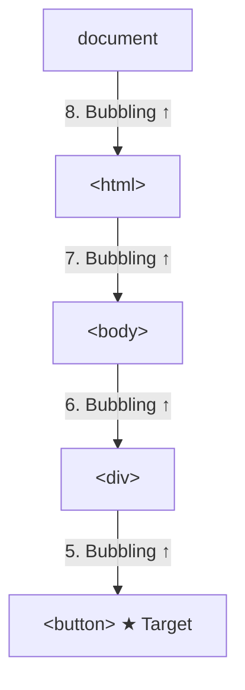

# Bubbling

## Introduction

By default, events **bubble** up from the target element through its ancestors to the document. This allows parent elements to handle events from their children.

## Visual Explanation



## Bubbling Example

```javascript
document.querySelector('button').addEventListener('click', () => {
  console.log('Button clicked');
});

document.querySelector('div').addEventListener('click', () => {
  console.log('Div clicked — bubbling!');
});

document.body.addEventListener('click', () => {
  console.log('Body clicked — bubbling!');
});

// Clicking the button logs:
// 'Button clicked'
// 'Div clicked — bubbling!'
// 'Body clicked — bubbling!'
```

## Events That Don't Bubble

Some events do NOT bubble: `focus`, `blur`, `mouseenter`, `mouseleave`, `scroll`, `load`, `unload`.

## Summary

- Events bubble from target up through ancestors
- Default behavior — most events bubble
- Enables event delegation pattern
- Some events (focus, blur) don't bubble

## Further Reading

- [MDN: Event bubbling](https://developer.mozilla.org/en-US/docs/Learn/JavaScript/Building_blocks/Events#event_bubbling)
