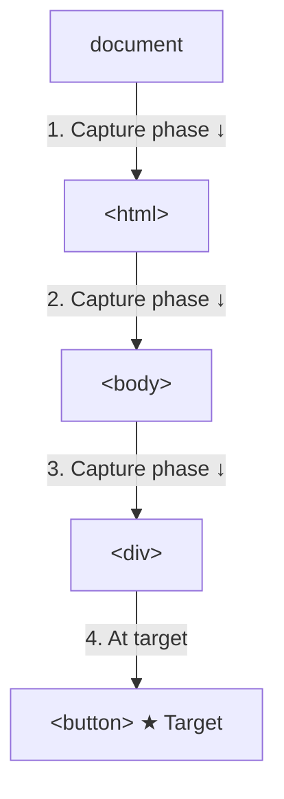

# Capturing

## Introduction

The **capturing** phase is the first phase of event propagation. Events travel from the document down to the target element before bubbling back up.

## Visual Explanation



## Using Capture Phase

```javascript
// Pass { capture: true } to listen during capture phase
document.querySelector('div').addEventListener('click', () => {
  console.log('Div — capturing phase!');
}, { capture: true });

document.querySelector('button').addEventListener('click', () => {
  console.log('Button — at target');
});

// Clicking the button logs:
// 'Div — capturing phase!'  ← capture runs first
// 'Button — at target'

// Shorthand: pass true instead of { capture: true }
parent.addEventListener('click', handler, true);
```

## When to Use Capturing

- Events that don't bubble (focus, blur, mouseenter)
- Intercepting events before they reach the target
- Global event monitoring/debugging

## Summary

- Capturing phase: document → target (downward)
- Set `{ capture: true }` or pass `true` as third argument
- Capturing listeners run before bubbling listeners
- Useful for events that don't bubble

## Further Reading

- [MDN: Event propagation](https://developer.mozilla.org/en-US/docs/Web/API/Event/eventPhase)
