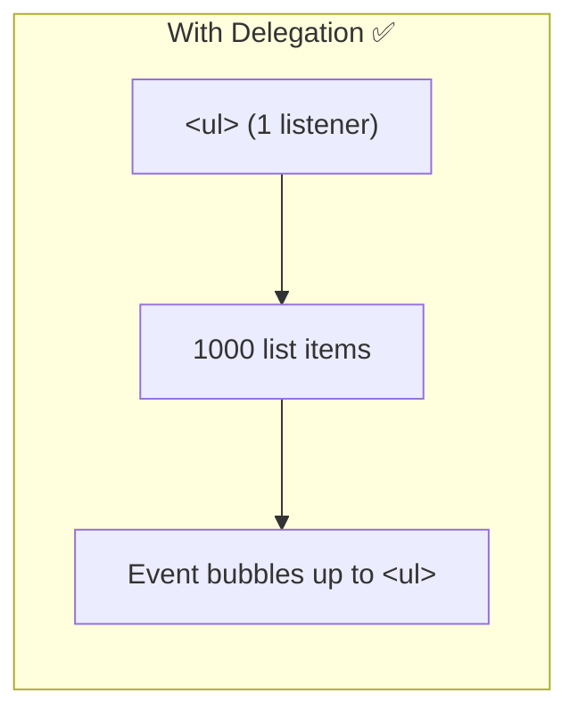

# With Delegation

## Introduction

Event delegation attaches a **single listener** to a parent element and uses the event's `target` to determine which child was interacted with.

## How It Works

```javascript
// ✅ Single listener on parent
document.querySelector('ul').addEventListener('click', (e) => {
  const item = e.target.closest('li');
  if (item) {
    console.log('Item clicked:', item.textContent);
  }
});
// Works for all items — existing and future!
```

## Visual Explanation



## Benefits

- ✅ Single listener vs thousands — less memory
- ✅ Works for dynamically added elements
- ✅ Easier to maintain and update
- ✅ Better performance

## Summary

- One parent listener handles all children via event bubbling
- Use `e.target.closest()` to identify the specific target
- Works for dynamically added elements
- Reduces memory usage and improves performance

## Further Reading

- [MDN: Event Delegation](https://developer.mozilla.org/en-US/docs/Learn/JavaScript/Building_blocks/Events#event_delegation)
