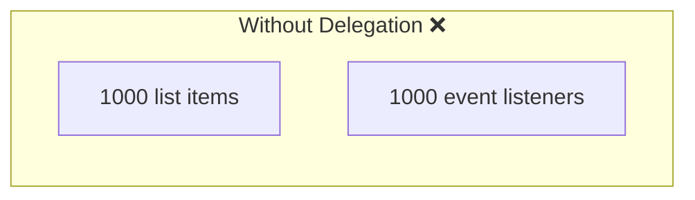

# Without Delegation

## Introduction

Without delegation, you attach an event listener to each individual element — which causes memory and performance issues.

## The Problem

```javascript
// ❌ Attaching listener to each item
document.querySelectorAll('.item').forEach(item => {
  item.addEventListener('click', () => {
    console.log('Item clicked:', item.textContent);
  });
});
```

## Issues

1. **Memory overhead** — each listener uses memory
2. **Performance** — attaching many listeners is slow
3. **Dynamic elements** — new elements added later won't have listeners
4. **Maintenance** — harder to remove or update handlers

## Visual Explanation



## Summary

- Each listener consumes memory
- Doesn't work for dynamically added elements
- Harder to maintain many individual listeners
- Event delegation solves all these problems

## Further Reading

- [MDN: Event Delegation](https://developer.mozilla.org/en-US/docs/Learn/JavaScript/Building_blocks/Events#event_delegation)
