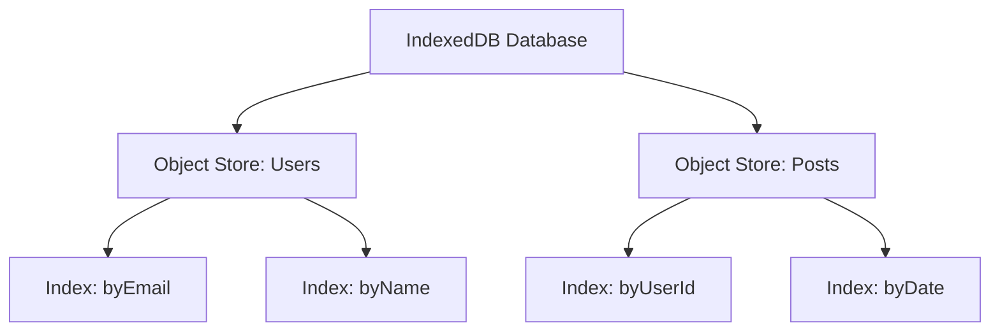

# Opening a Database

## Introduction

Opening an IndexedDB database involves version management and schema setup via the `onupgradeneeded` event.

## Basic Setup

```javascript
const request = indexedDB.open('MyAppDB', 1);

request.onupgradeneeded = (event) => {
  const db = event.target.result;

  // Create object stores (like tables)
  const store = db.createObjectStore('users', {
    keyPath: 'id',
    autoIncrement: true
  });

  // Create indexes for querying
  store.createIndex('email', 'email', { unique: true });
  store.createIndex('name', 'name', { unique: false });
};

request.onsuccess = (event) => {
  const db = event.target.result;
  console.log('Database opened:', db);
};

request.onerror = (event) => {
  console.error('Database error:', event.target.error);
};
```

## Visual Explanation



## Version Management

```javascript
// Version 2 adds a new object store
const request = indexedDB.open('MyAppDB', 2);

request.onupgradeneeded = (event) => {
  const db = event.target.result;

  // Check if store already exists
  if (!db.objectStoreNames.contains('posts')) {
    const store = db.createObjectStore('posts', { keyPath: 'id' });
    store.createIndex('userId', 'userId', { unique: false });
  }
};
```

## Summary

- `indexedDB.open(name, version)` opens or creates a database
- `onupgradeneeded` fires when version changes or DB is new
- Create object stores and indexes in `onupgradeneeded`
- `onsuccess` fires when the database is ready to use

## Further Reading

- [MDN: IndexedDB API](https://developer.mozilla.org/en-US/docs/Web/API/IndexedDB_API)
