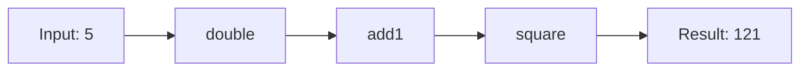

# Composition

## Introduction

**Function composition** is combining simple functions to build more complex ones. Data flows through a pipeline of functions.

## Visual Explanation



## compose (Right-to-Left)

```javascript
const compose = (...fns) => (x) => fns.reduceRight((acc, fn) => fn(acc), x);

const double = x => x * 2;
const add1 = x => x + 1;
const square = x => x * x;

const transform = compose(square, add1, double);
console.log(transform(5)); // square(add1(double(5))) = (5*2+1)² = 121
```

## pipe (Left-to-Right)

```javascript
const pipe = (...fns) => (x) => fns.reduce((acc, fn) => fn(acc), x);

const double = x => x * 2;
const add1 = x => x + 1;
const square = x => x * x;

const transform = pipe(double, add1, square);
console.log(transform(5)); // square(add1(double(5))) = 121

// Same result, but reads left-to-right
```

## Practical Example

```javascript
const users = [
  { name: 'Alice', age: 17 },
  { name: 'Bob', age: 22 },
  { name: 'Charlie', age: 30 }
];

const filterAdults = (users) => users.filter(u => u.age >= 18);
const getNames = (users) => users.map(u => u.name);
const sortNames = (names) => names.sort();

const getAdultNames = pipe(filterAdults, getNames, sortNames);
console.log(getAdultNames(users)); // ['Bob', 'Charlie']
```

## Summary

- **compose**: right-to-left
- **pipe**: left-to-right (more intuitive)
- Builds complex operations from simple functions
- Core concept in functional programming

## Further Reading

- [MDN: Function Composition](https://developer.mozilla.org/en-US/docs/Glossary/Function_composition)
