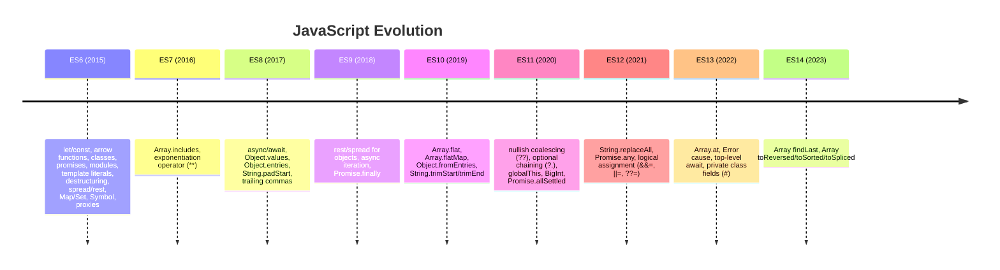

# Feature Timeline

## Introduction

JavaScript evolves through annual ECMAScript releases. Here's a timeline of major features.

## Timeline

## Most Impactful Releases

| Year | Version | Impact |
|------|---------|--------|
| 2015 | ES6 | Biggest update — transformed JavaScript |
| 2017 | ES8 | async/await changed async programming |
| 2020 | ES11 | Optional chaining, nullish coalescing |

## Summary

- ES6 (2015) was the most significant update
- Annual releases since 2016 provide steady improvements
- Features go through TC39 stages (0-4) before inclusion
- Modern browsers support ES6+ features well

## Further Reading

- [TC39 Proposals](https://tc39.es/ecma262/)
