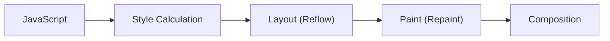

# Rendering, Repaint & Reflow

## Introduction

When you change the DOM or CSS, the browser recalculates styles, lays out elements, and paints pixels. Understanding this pipeline helps you write performant code.

## Topics Covered

- [The Rendering Pipeline](./rendering-pipeline) — Style calculation, layout, paint, and compositing
- [Reflow Triggers](./reflow-triggers) — What causes layout recalculations and how to avoid them
- [Compositing & GPU](./compositing-gpu) — Using transform and opacity for GPU-accelerated animations

## The Rendering Pipeline



## Reflow (Layout)

Reflow recalculates the **position and size** of elements. It's expensive because it affects the entire document tree.

```javascript
// ❌ Triggers reflow (expensive)
element.style.width = '100px';
element.style.height = '200px';
element.style.margin = '10px';

// ✅ Batch reads/writes to avoid forced reflow
// Read first, then write
const height = element.offsetHeight; // Read
element.style.height = height + 10 + 'px'; // Write
```

### What Triggers Reflow

- Adding/removing DOM elements
- Changing dimensions (width, height, margin, padding)
- Changing font, font-size
- Changing positioning (position, top, left)
- `offsetHeight`, `offsetWidth`, `getBoundingClientRect()` (read)

## Repaint (Paint)

Repaint happens when visual changes don't affect layout — like changing `color`, `background-color`, `visibility`, or `outline`.

```javascript
// ✅ Only triggers repaint (cheaper)
element.style.color = 'red';
element.style.backgroundColor = '#f0f0f0';

// ❌ Triggers reflow (expensive)
element.style.width = '50%';
```

## Compositing (GPU)

The most performant changes only trigger **compositing** — they don't affect layout or paint:

```javascript
// ✅ Only triggers compositing (fastest!)
element.style.transform = 'rotate(45deg)';
element.style.opacity = '0.5';
```

## Best Practices

```javascript
// 1. Use CSS classes instead of inline styles (batch changes)
element.classList.add('active');

// 2. Use transform/opacity for animations (GPU accelerated)
element.style.transform = 'translateX(100px)';

// 3. Minimize layout thrashing — read, then write
const width = element.offsetWidth; // Read once
elements.forEach(el => {
  el.style.width = (width / 2) + 'px'; // Write many times
});

// 4. Use DocumentFragment for batch DOM insertions
const fragment = document.createDocumentFragment();
items.forEach(item => fragment.appendChild(createElement(item)));
container.appendChild(fragment);

// 5. Use content-visibility for off-screen content
// CSS: content-visibility: auto
```

## Summary

| Change | Cost | Properties |
|--------|------|------------|
| Reflow | Expensive | width, height, margin, font |
| Repaint | Moderate | color, background, visibility |
| Compositing | Cheap 🚀 | transform, opacity |

## Further Reading

- [MDN: Rendering Performance](https://developer.mozilla.org/en-US/docs/Web/Performance/Critical_rendering_path)
- [Web.dev: Rendering Performance](https://web.dev/learn/performance/rendering/)
