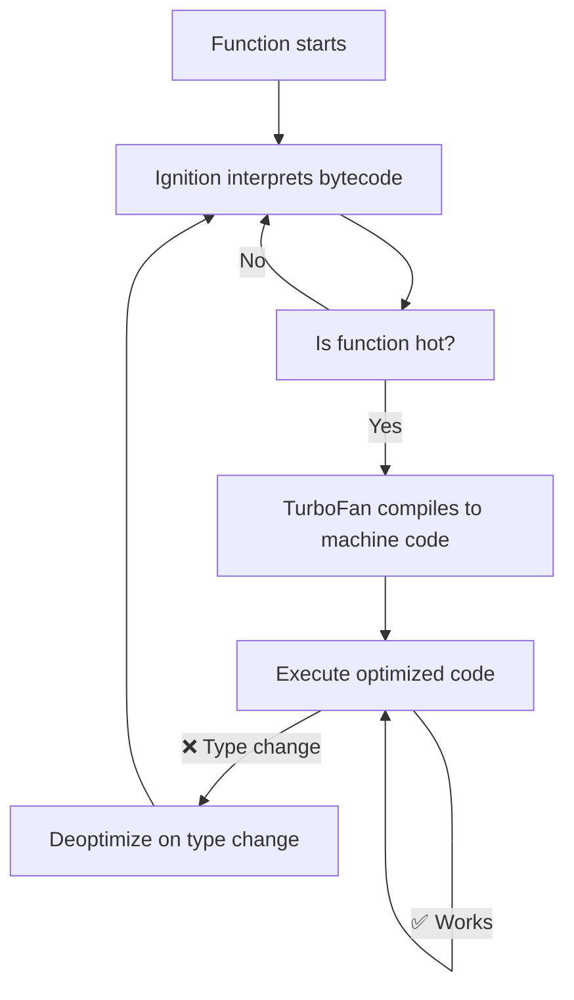

# Compiler & Interpreter

## Introduction

Modern JavaScript engines use a **JIT (Just-In-Time) compilation** approach — they interpret code initially for fast startup and compile hot paths to machine code for performance.

## Interpreter (Ignition)

V8's Ignition interpreter executes bytecode directly. It's fast to start but slower than compiled code.

```javascript
// Bytecode (Ignition)
// LdaGlobal 'console'     ; Load global
// Star0                   ; Store
// LdaNamedProperty r0, 'log'
// Star1
// LdaSmi [42]
// CallProperty1 r1, r0
```

## Compiler (TurboFan)

TurboFan compiles frequently executed ("hot") functions to highly optimized machine code.



## Compilation vs Interpretation

| Feature | Interpreter | Compiler |
|---------|-------------|----------|
| Start time | Fast | Slow |
| Execution speed | Slow | Fast |
| Optimization | None | Extensive |
| Memory | Less | More |

## Summary

- Interpretation: fast start, slow execution (Ignition)
- Compilation: slow start, fast execution (TurboFan)
- JIT combines both — starts interpreting, compiles hot paths
- Can deoptimize when assumptions break

## Further Reading

- [V8: Ignition](https://v8.dev/docs/ignition)
- [V8: TurboFan](https://v8.dev/docs/turbofan)
