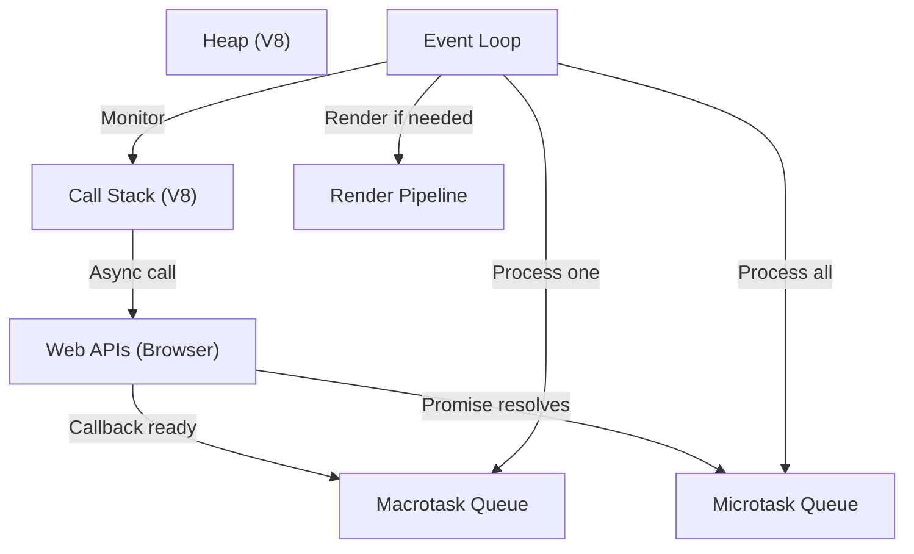

# Event Loop Internals

## Introduction

The event loop is not part of JavaScript itself — it's provided by the **host environment** (browser or Node.js). This deep dive covers what happens at the engine level.

## Full Architecture



## Execution Order (Deep)

```javascript
console.log('1');

setTimeout(() => console.log('2'), 0);

Promise.resolve().then(() => {
  console.log('3');
  
  setTimeout(() => console.log('4'), 0);
  
  Promise.resolve().then(() => console.log('5'));
});

console.log('6');

// Output: 1, 6, 3, 5, 2, 4
// Step-by-step:
// 1. Sync: 1, 6
// 2. Microtask queue: 3, 5 (promises)
// 3. Macrotask queue: 2
// 4. Next macrotask: 4
```

## requestAnimationFrame Timing

```javascript
// RAF runs BEFORE the next paint, AFTER microtasks
setTimeout(() => console.log('timeout'), 0);
Promise.resolve().then(() => console.log('promise'));
requestAnimationFrame(() => console.log('raf'));
// Output: promise, raf, timeout
```

## Summary

- Event loop is provided by the host environment, not JS engine
- Each iteration: 1 macrotask → all microtasks → render (if needed)
- `requestAnimationFrame` runs before paint, after microtasks

## Further Reading

- [HTML Spec: Event Loop](https://html.spec.whatwg.org/multipage/webappapis.html#event-loop-processing-model)
- [Node.js: Event Loop](https://nodejs.org/en/docs/guides/event-loop-timers-and-nexttick/)
