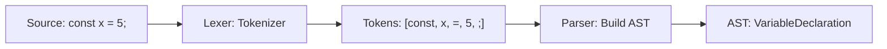

# Parser

## Introduction

The parser converts JavaScript source code into an **Abstract Syntax Tree (AST)** — a tree representation of the code's structure.

## Parsing Process



## Tokenization (Lexing)

```javascript
// Source code
const x = 5;

// Tokens produced
// [Keyword: const] [Identifier: x] [Operator: =] [Number: 5] [Punctuator: ;]
```

## AST Structure

```
Program
 ├── VariableDeclaration (const)
 │   ├── VariableDeclarator
 │   │   ├── Identifier (x)
 │   │   └── NumericLiteral (5)
```

## Eager vs Lazy Parsing

V8 uses two parsing modes:
- **Eager**: Parses functions immediately (slower start)
- **Lazy**: Skips function bodies until called (faster start, used by default)

```javascript
// Lazily parsed — body skipped until called
function greet() {
  console.log('Hello');
}

// Eagerly parsed with parens
const greet = (function() {
  console.log('Hello');
});
```

## Summary

- Parser converts source → AST
- Lexer tokenizes, Parser builds tree
- V8 uses lazy parsing for faster startup
- AST is input for the interpreter

## Further Reading

- [V8: Parsing](https://v8.dev/blog/preparser)
- [AST Explorer](https://astexplorer.net/)
