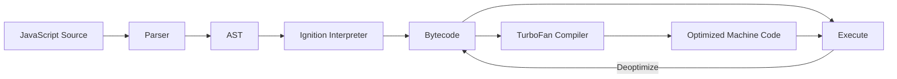

# V8 Architecture

## Introduction

V8 is Google's open-source JavaScript engine used in Chrome, Node.js, Deno, and Electron. It compiles JavaScript to machine code.

## Pipeline Overview

## Key Components

- **Parser**: Creates AST (Abstract Syntax Tree)
- **Ignition**: Fast interpreter that produces bytecode
- **TurboFan**: Optimizing JIT compiler
- **Orinoco**: Garbage collector
- **Memory Manager**: Heap and stack management

## Compilation Pipeline

1. Source code → Parser → AST
2. AST → Ignition → Bytecode
3. Bytecode execution starts immediately
4. Hot (frequently executed) functions → TurboFan → Optimized machine code
5. If assumptions fail → Deoptimize → Back to bytecode

## Summary

- V8 uses a multi-tier architecture
- Starts fast with Ignition interpreter
- Optimizes hot code with TurboFan
- Can deoptimize when assumptions change

## Further Reading

- [V8 Docs](https://v8.dev/docs)
- [V8: How V8 Works](https://v8.dev/docs/ignition)
