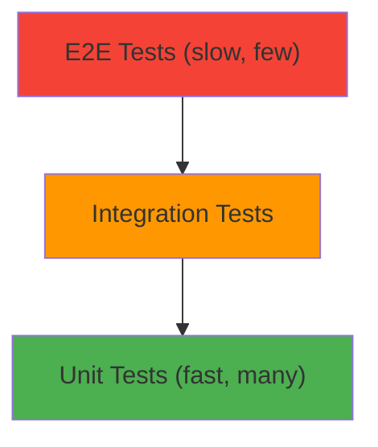

# Testing

## Introduction

Testing ensures your code works correctly and prevents regressions. A good test suite gives you confidence to refactor and ship changes quickly.

## Testing Pyramid



## Unit Testing

```javascript
// Vitest / Jest
import { describe, it, expect } from 'vitest';

function add(a, b) { return a + b; }

describe('add', () => {
  it('adds two numbers', () => {
    expect(add(2, 3)).toBe(5);
  });
  
  it('handles negative numbers', () => {
    expect(add(-1, -2)).toBe(-3);
  });
});
```

## Integration Testing

```javascript
import { render, screen, fireEvent } from '@testing-library/react';

describe('LoginForm', () => {
  it('shows error for invalid email', async () => {
    render(<LoginForm />);
    
    fireEvent.change(screen.getByLabelText('Email'), {
      target: { value: 'invalid' }
    });
    fireEvent.click(screen.getByText('Submit'));
    
    expect(await screen.findByText('Invalid email')).toBeInTheDocument();
  });
});
```

## E2E Testing

```javascript
// Playwright
test('user can log in', async ({ page }) => {
  await page.goto('/login');
  await page.fill('[name="email"]', 'user@example.com');
  await page.fill('[name="password"]', 'password123');
  await page.click('button[type="submit"]');
  await expect(page).toHaveURL('/dashboard');
});
```

## Summary

- Unit tests: fast, many, test individual functions
- Integration tests: test component interactions
- E2E tests: slow, few, test complete user flows
- Aim for 70–80% code coverage

## Further Reading

- [Vitest](https://vitest.dev/)
- [Testing Library](https://testing-library.com/)
- [Playwright](https://playwright.dev/)
