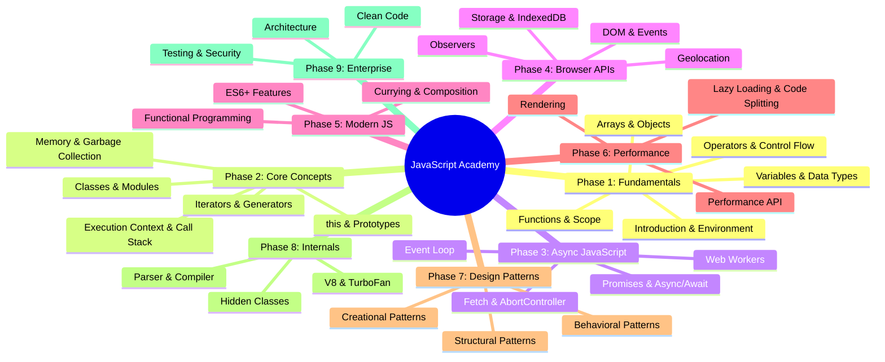
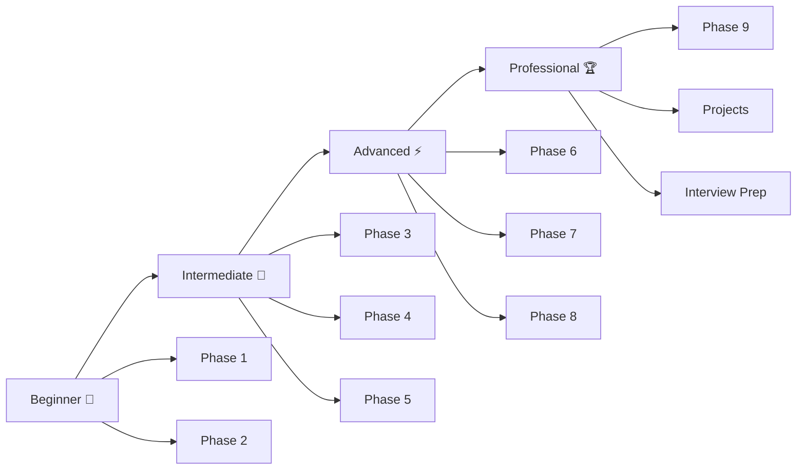

# JavaScript Learning Roadmap

## The Complete JavaScript Journey

## Learning Progression

## Estimated Timeline

| Phase | Level | Time |
|-------|-------|------|
| Phase 1 — Fundamentals | Beginner | 2-3 weeks |
| Phase 2 — Core Concepts | Beginner | 2-3 weeks |
| Phase 3 — Async JS | Intermediate | 1-2 weeks |
| Phase 4 — Browser APIs | Intermediate | 2-3 weeks |
| Phase 5 — Modern JS | Intermediate | 1-2 weeks |
| Phase 6 — Performance | Advanced | 1 week |
| Phase 7 — Design Patterns | Advanced | 1-2 weeks |
| Phase 8 — Internals | Advanced | 1 week |
| Phase 9 — Enterprise | Professional | 1-2 weeks |
| **Total** | | **12-18 weeks** |
