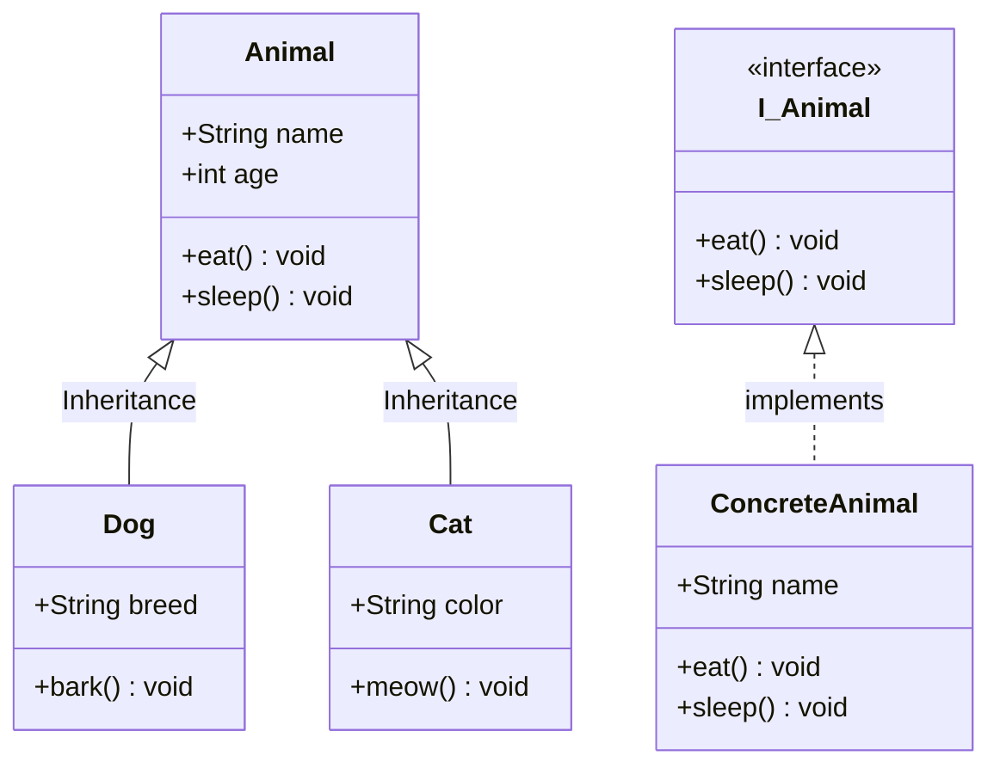
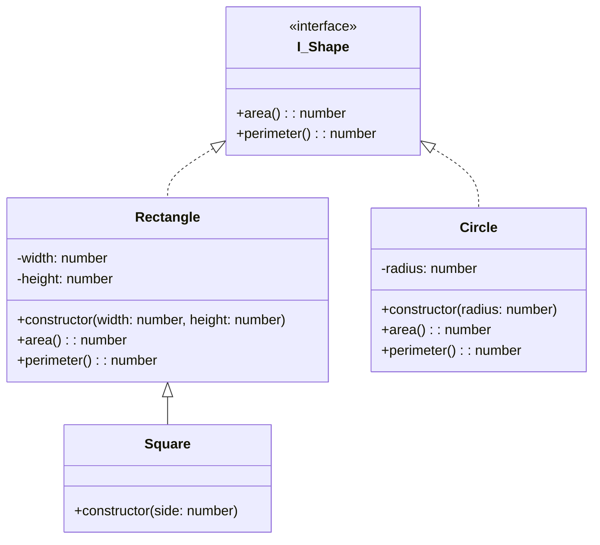

## 01 — OOP Fundamentals

**Object-Oriented Programming (OOP)** is a programming paradigm based on the concept of "objects" containing data (properties) and code (methods). It's the foundation of LLD.

> **Analogy:** OOP is like organizing a restaurant. You have different objects: chefs, waiters, menus, tables. Each object has its own data (chef's recipes, waiter's section) and behaviors (chef cooks, waiter serves). Objects interact with each other through predefined interfaces.

---

### Problem Statement

Without OOP principles:
- Code is duplicated across the codebase
- Changes in one place break things in unexpected places
- Large systems become unmaintainable "spaghetti code"
- Difficult to model real-world entities and their relationships

---

### The Four Pillars of OOP



**1. Encapsulation** — Bundle data and methods that operate on that data, hiding internal state

```typescript
// JavaScript (using closures)
function createBankAccount(initialBalance: number) {
  let balance = initialBalance; // Private variable
  
  return {
    deposit(amount: number) {
      if (amount > 0) balance += amount;
    },
    withdraw(amount: number) {
      if (amount <= balance) { balance -= amount; return true; }
      return false;
    },
    getBalance() { return balance; }
  };
}

// TypeScript (using private keyword)
class BankAccount {
  private balance: number;
  
  constructor(initialBalance: number) {
    this.balance = initialBalance;
  }
  
  deposit(amount: number): void {
    if (amount > 0) this.balance += amount;
  }
  
  withdraw(amount: number): boolean {
    if (amount <= this.balance) {
      this.balance -= amount;
      return true;
    }
    return false;
  }
  
  getBalance(): number {
    return this.balance;
  }
}
```

**2. Inheritance** — Create new classes based on existing ones

```typescript
// TypeScript
class Vehicle {
  constructor(public make: string, public model: string) {}
  
  start(): void {
    console.log(`${this.make} ${this.model} starting...`);
  }
}

class Car extends Vehicle {
  constructor(make: string, model: string, public doors: number) {
    super(make, model);
  }
  
  honk(): void {
    console.log("Beep beep!");
  }
}
```

**3. Polymorphism** — Objects of different types respond to the same interface

```typescript
// TypeScript
interface PaymentMethod {
  pay(amount: number): void;
}

class CreditCard implements PaymentMethod {
  pay(amount: number): void {
    console.log(`Paid $${amount} via Credit Card`);
  }
}

class PayPal implements PaymentMethod {
  pay(amount: number): void {
    console.log(`Paid $${amount} via PayPal`);
  }
}

function checkout(payment: PaymentMethod, amount: number): void {
  payment.pay(amount); // Polymorphic call
}

checkout(new CreditCard(), 100); // "Paid $100 via Credit Card"
checkout(new PayPal(), 200);     // "Paid $200 via PayPal"
```

**4. Abstraction** — Hide complexity, show only essential features

```typescript
// TypeScript — Abstract class
abstract class Database {
  abstract connect(): void;
  abstract query(sql: string): any[];
  abstract disconnect(): void;
  
  // Shared concrete method
  find(id: number): any {
    this.connect();
    const result = this.query(`SELECT * FROM users WHERE id = ${id}`);
    this.disconnect();
    return result;
  }
}

class MySQLDatabase extends Database {
  connect(): void { /* MySQL connection logic */ }
  query(sql: string): any[] { /* MySQL query */ return []; }
  disconnect(): void { /* MySQL disconnect */ }
}
```

---

### Mermaid Class Diagram — Full Example



---

### Design Decisions

| Principle | Decision | Why |
|-----------|----------|-----|
| **Encapsulation** | Private fields, public methods | Prevents invalid state (e.g., negative balance) |
| **Inheritance** | Use sparingly, prefer composition | Deep inheritance hierarchies are fragile |
| **Polymorphism** | Depend on interfaces, not concrete classes | Swap implementations without changing callers |
| **Abstraction** | Abstract classes for shared state, interfaces for behavior | Clear contract between components |

---

### Interview Questions

1. **What are the four pillars of OOP? Explain each with an example.**
2. **What's the difference between encapsulation and abstraction?**
3. **How does polymorphism improve code maintainability?**
4. **Why is composition preferred over inheritance?**
5. **What is the diamond problem in multiple inheritance?**

---

### In Simple Words

- **Encapsulation** = keep data private, expose only what's needed via methods
- **Inheritance** = child classes get parent's properties and methods (is-a relationship)
- **Polymorphism** = same method name, different behavior across classes
- **Abstraction** = hide complexity, show only the essential interface
- **Composition over inheritance** — prefer "has-a" over "is-a" relationships
- OOP helps manage complexity by modeling real-world entities as objects
