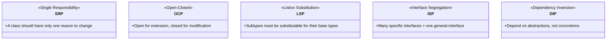
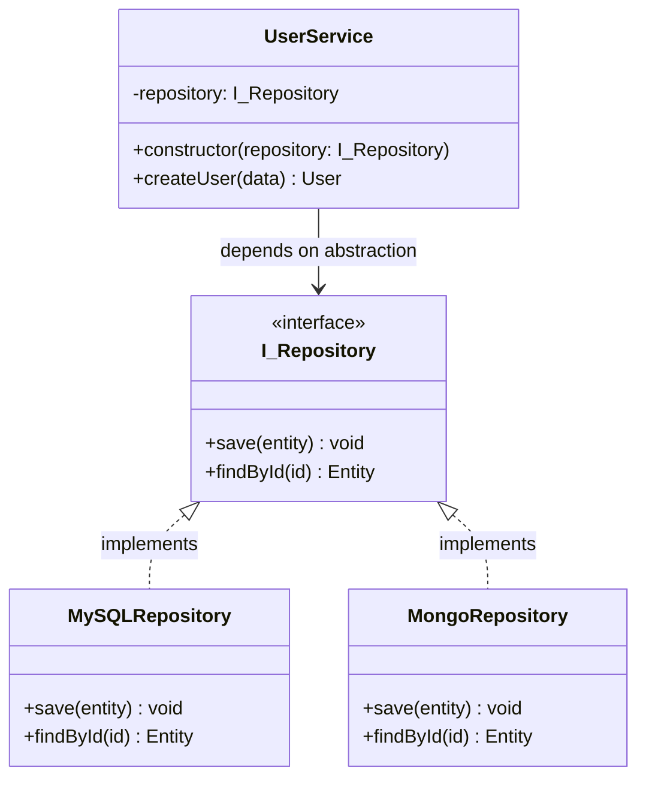

## 02 — SOLID Principles

**SOLID** is an acronym for five design principles that help create maintainable, scalable, and testable object-oriented software. They're the foundation of good LLD.

> **Analogy:** SOLID principles are like building codes for a house. Following them doesn't guarantee a beautiful house, but ignoring them guarantees a dangerous one.

---

### Problem Statement

Without SOLID principles:
- **S** — Classes become God objects with too many responsibilities
- **O** — Every new feature requires editing existing, tested code
- **L** — Subclasses break parent class contracts, causing bugs
- **I** — Classes are forced to implement methods they don't need
- **D** — High-level modules depend on low-level details, making testing impossible

---

### SOLID Overview



---

### S — Single Responsibility Principle

**A class should have only one reason to change.**

```typescript
// ❌ Bad: Class has multiple responsibilities
class Invoice {
  calculateTotal(): number { /* ... */ }
  saveToDatabase(): void { /* ... */ }
  sendEmail(): void { /* ... */ }
  printInvoice(): void { /* ... */ }
}

// ✅ Good: Each class has one responsibility
class InvoiceCalculator {
  calculateTotal(items: Item[]): number { /* ... */ }
}

class InvoiceRepository {
  save(invoice: Invoice): void { /* ... */ }
}

class EmailService {
  sendInvoice(email: string, invoice: Invoice): void { /* ... */ }
}

class InvoicePrinter {
  print(invoice: Invoice): string { /* ... */ }
}
```

---

### O — Open-Closed Principle

**Open for extension, closed for modification.**

```typescript
// ❌ Bad: Need to modify this class to add new shapes
class AreaCalculator {
  calculateArea(shape: any): number {
    if (shape.type === 'circle') return Math.PI * shape.radius ** 2;
    if (shape.type === 'rectangle') return shape.width * shape.height;
    // Need to add more if-else for new shapes
  }
}

// ✅ Good: Extend without modifying
interface Shape {
  area(): number;
}

class Circle implements Shape {
  constructor(private radius: number) {}
  area(): number { return Math.PI * this.radius ** 2; }
}

class Rectangle implements Shape {
  constructor(private width: number, private height: number) {}
  area(): number { return this.width * this.height; }
}

class AreaCalculator {
  calculateArea(shape: Shape): number {
    return shape.area(); // No modification needed for new shapes
  }
}
```

---

### L — Liskov Substitution Principle

**Subtypes must be substitutable for their base types.**

```typescript
// ❌ Bad: Violates LSP
class Bird {
  fly(): void { console.log("Flying"); }
}

class Penguin extends Bird {
  fly(): void { throw new Error("Penguins can't fly!"); }
}

function makeBirdFly(bird: Bird): void {
  bird.fly(); // Crashes for Penguin
}

// ✅ Good: Better hierarchy
interface Bird {
  eat(): void;
}

interface FlyingBird extends Bird {
  fly(): void;
}

class Sparrow implements FlyingBird {
  eat(): void { console.log("Eating"); }
  fly(): void { console.log("Flying"); }
}

class Penguin implements Bird {
  eat(): void { console.log("Eating"); }
  // No fly method — Penguin is a Bird but not a FlyingBird
}
```

---

### I — Interface Segregation Principle

**Many specific interfaces are better than one general interface.**

```typescript
// ❌ Bad: Fat interface
interface Worker {
  work(): void;
  eat(): void;
  sleep(): void;
}

class Robot implements Worker {
  work(): void { /* works */ }
  eat(): void { throw new Error("Robots don't eat"); }
  sleep(): void { throw new Error("Robots don't sleep"); }
}

// ✅ Good: Segregated interfaces
interface Workable {
  work(): void;
}

interface Eatable {
  eat(): void;
}

interface Sleepable {
  sleep(): void;
}

class HumanWorker implements Workable, Eatable, Sleepable {
  work(): void { /* works */ }
  eat(): void { /* eats */ }
  sleep(): void { /* sleeps */ }
}

class RobotWorker implements Workable {
  work(): void { /* works */ }
}
```

---

### D — Dependency Inversion Principle

**Depend on abstractions, not concretions.**

```typescript
// ❌ Bad: High-level module depends on low-level detail
class MySQLDatabase {
  save(data: any): void { /* MySQL specific */ }
}

class UserService {
  constructor(private db: MySQLDatabase) {} // Tight coupling
  saveUser(user: any): void { this.db.save(user); }
}

// ✅ Good: Both depend on abstraction
interface Database {
  save(data: any): void;
}

class MySQLDatabase implements Database {
  save(data: any): void { /* MySQL specific */ }
}

class MongoDBDatabase implements Database {
  save(data: any): void { /* MongoDB specific */ }
}

class UserService {
  constructor(private db: Database) {} // Loose coupling
  saveUser(user: any): void { this.db.save(user); }
}
```

---

### Mermaid Class Diagram — SOLID in Action



---

### Interview Questions

1. **Explain each SOLID principle with a real-world example.**
2. **What happens when you violate the Liskov Substitution Principle?**
3. **How does Dependency Inversion help with testing?**
4. **What's the difference between Interface Segregation and Single Responsibility?**
5. **Can you over-apply SOLID principles? When is it too much?**

---

### In Simple Words

- **SRP** = one class, one job (like a chef who only cooks, not also serves and cleans)
- **OCP** = add new features by writing new code, not changing old code
- **LSP** = subclasses should work wherever their parent works (Penguin can't substitute Bird)
- **ISP** = don't force classes to implement methods they don't need
- **DIP** = depend on interfaces/abstract classes, not concrete implementations
- SOLID makes code **testable, maintainable, and flexible** — the cost is more files/classes
