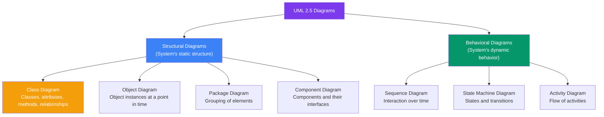
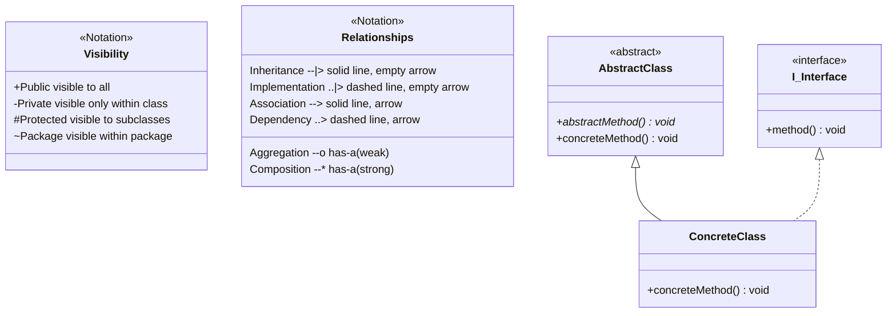
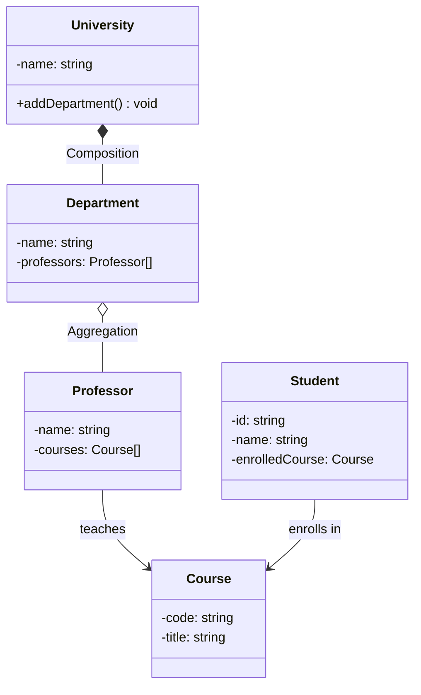
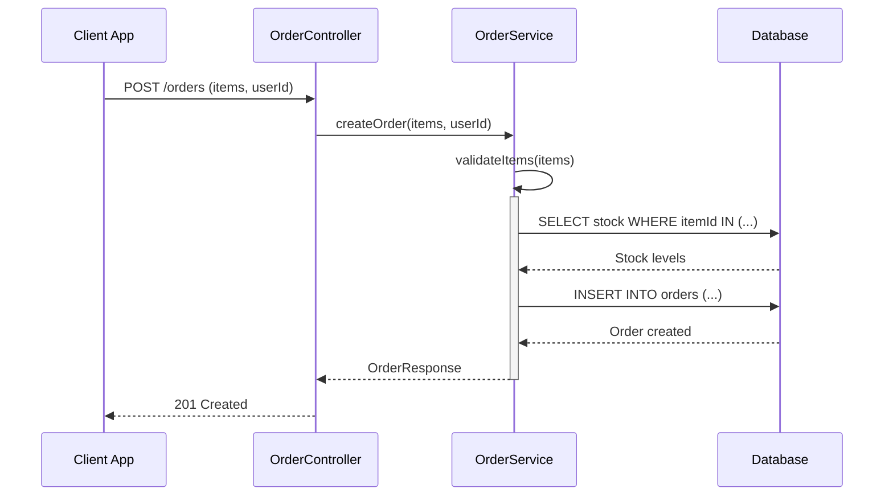

## 03 — UML Basics

**Unified Modeling Language (UML)** is a standardized visual language for specifying, constructing, and documenting software systems. It's the sketching language of software design.

> **Analogy:** UML diagrams are like architectural blueprints. Architects use specific symbols and notations so everyone (contractors, electricians, plumbers) can read the plans. UML provides standard symbols so all developers can understand the design.

---

### Problem Statement

Without UML:
- Designs are described in paragraphs — imprecise and open to interpretation
- Class relationships are unclear until code is written
- Communication between team members is inefficient
- Design issues are discovered during implementation, not before

---

### Types of UML Diagrams

---

### UML Notation Reference

---

### Key UML Relationships

---

### Relationship Types

| Relationship | Notation | Arrow | Meaning | Strength | Example |
|-------------|----------|-------|---------|----------|---------|
| **Inheritance** | `--|>` | Solid line, empty triangle | "is-a" | Strong | Dog → Animal |
| **Implementation** | `..|>` | Dashed line, empty triangle | "implements" | Medium | Car → Drivable |
| **Association** | `-->` | Solid line, arrow | "has-a" (uses) | Weak | Teacher → Student |
| **Aggregation** | `--o` | Solid line, empty diamond | "has-a" (optional part) | Medium | Department → Professor |
| **Composition** | `--*` | Solid line, filled diamond | "has-a" (owned part) | Strong | University → Department |
| **Dependency** | `..>` | Dashed line, arrow | "uses temporarily" | Weakest | Order → EmailService |

---

### Sequence Diagram Example

---

### Common Diagrams for LLD

| Diagram | Purpose | When to Use |
|---------|---------|-------------|
| **Class Diagram** | Show classes, attributes, methods, relationships | Almost always — the main LLD diagram |
| **Sequence Diagram** | Show interaction flow over time | When object interaction is complex |
| **State Diagram** | Show states and transitions | When object has complex state (e.g., Order: Created → Paid → Shipped) |
| **Activity Diagram** | Show workflow or algorithm steps | When business logic flow is complex |

---

### Interview Questions

1. **What are the main types of UML diagrams? Which is most important for LLD?**
2. **What's the difference between aggregation and composition?**
3. **How would you represent a many-to-many relationship in a class diagram?**
4. **When would you use a sequence diagram vs a class diagram?**
5. **What does the `+`, `-`, `#` notation mean in UML?**

---

### In Simple Words

- **UML** = standard way to draw software designs — everyone can read it
- **Class diagrams** are the most important for LLD — they show classes and their relationships
- **Sequence diagrams** show how objects interact over time (method calls, responses)
- **Inheritance** = is-a (solid line, empty triangle)
- **Composition** = strong has-a (filled diamond) — child can't exist without parent
- **Aggregation** = weak has-a (empty diamond) — child can exist without parent
- For LLD, master **class diagrams** and **sequence diagrams** — they cover 90% of needs
