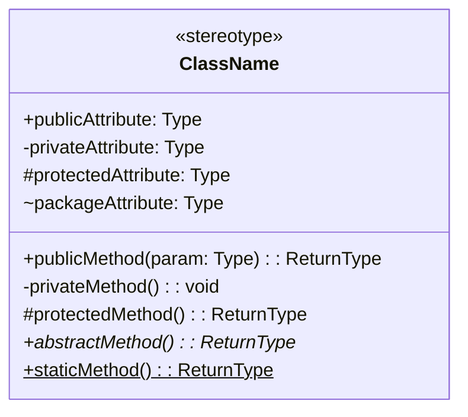
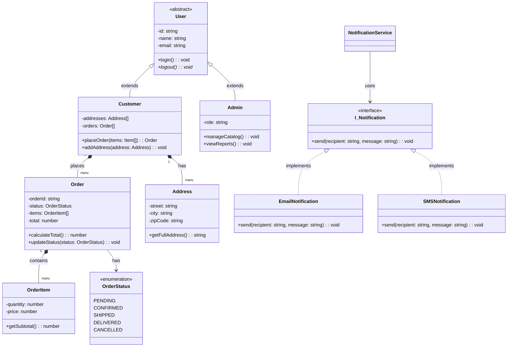

## 04 — Class Diagrams

**Class diagrams** are the most important UML diagram for LLD. They show the static structure of a system: classes, their attributes and methods, and the relationships between them.

> **Analogy:** A class diagram is like an organizational chart. It shows who (classes) works in the company, what their role is (methods), what tools they have (attributes), and who reports to whom (relationships).

---

### Problem Statement

Without class diagrams:
- Developers start coding without understanding the full picture
- Class relationships are discovered through trial and error
- Design flaws are found during coding, requiring rewrites
- Communication between team members about design is imprecise

---

### Class Diagram Elements



| Notation | Element | Example |
|----------|---------|---------|
| `ClassName` | Class name (bold, centered) | `User` |
| `<<stereotype>>` | Stereotype (interface, abstract, enum) | `<<interface>>` |
| `+` | Public (accessible everywhere) | `+getName(): string` |
| `-` | Private (accessible only within class) | `-password: string` |
| `#` | Protected (accessible in subclasses) | `#id: number` |
| `$` | Static (class-level) | `$instance: Singleton` |
| `*` | Abstract method | `+calculate(): number*` |
| `:` | Separates name from type | `name: string` |

---

### Complete Class Diagram Example — E-Commerce System



---

### Key Parts of a Class Diagram

| Component | Description | Example |
|-----------|-------------|---------|
| **Class** | Blueprint for objects | `Customer`, `Order` |
| **Interface** | Contract of methods | `I_Notification` |
| **Abstract class** | Partial implementation | `User` (with abstract `logout`) |
| **Enumeration** | Fixed set of values | `OrderStatus` |
| **Attributes** | Properties/fields | `-name: string` |
| **Methods** | Behaviors | `+login(): void` |
| **Relationships** | How classes connect | Lines between classes |

---

### TypeScript Example — From Diagram to Code

```typescript
// Interface
interface INotification {
  send(recipient: string, message: string): void;
}

// Enum
enum OrderStatus {
  PENDING, CONFIRMED, SHIPPED, DELIVERED, CANCELLED
}

// Address class
class Address {
  constructor(
    public street: string,
    public city: string,
    public zipCode: string
  ) {}
  getFullAddress(): string {
    return `${this.street}, ${this.city} ${this.zipCode}`;
  }
}

// OrderItem class
class OrderItem {
  constructor(public quantity: number, public price: number) {}
  getSubtotal(): number { return this.quantity * this.price; }
}

// Order class
class Order {
  public orderId: string = Math.random().toString(36);
  public status: OrderStatus = OrderStatus.PENDING;
  public items: OrderItem[] = [];
  public total: number = 0;
  
  calculateTotal(): number {
    this.total = this.items.reduce((sum, item) => sum + item.getSubtotal(), 0);
    return this.total;
  }
}

// Email notification implements interface
class EmailNotification implements INotification {
  send(recipient: string, message: string): void {
    console.log(`Email to ${recipient}: ${message}`);
  }
}
```

---

### Design Decisions

| Decision | Guideline |
|----------|-----------|
| **Interface vs Abstract class** | Interface for behavior contract; Abstract class for shared state + behavior |
| **Composition vs Inheritance** | Prefer composition (has-a) — it's more flexible |
| **Visibility** | Start with private, expose only what's needed |
| **Single Responsibility** | Each class should do one thing well |

---

### Interview Questions

1. **Draw a class diagram for a library management system.**
2. **When do you use an abstract class vs an interface?**
3. **How do you represent a many-to-many relationship in a class diagram?**
4. **What's the difference between a class diagram and an object diagram?**
5. **How do you decide what should be an attribute vs a separate class?**

---

### In Simple Words

- **Class diagram** = blueprint showing all classes and how they connect
- **+ (public)**, **- (private)**, **# (protected)** — visibility of attributes and methods
- **Interfaces** have `<<interface>>`, abstract classes have `<<abstract>>`
- **Inheritance** = empty triangle; **Composition** = filled diamond; **Aggregation** = empty diamond
- A good class diagram is the foundation of a good implementation
- Always design the class diagram **before** writing code — it saves time and prevents mistakes
