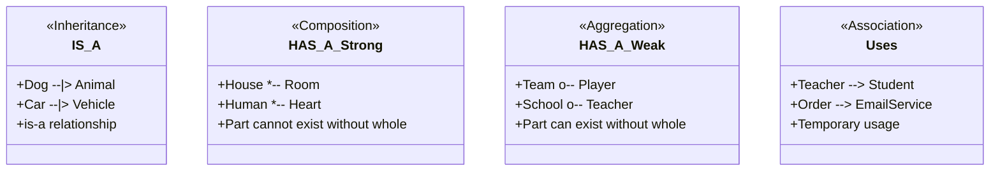
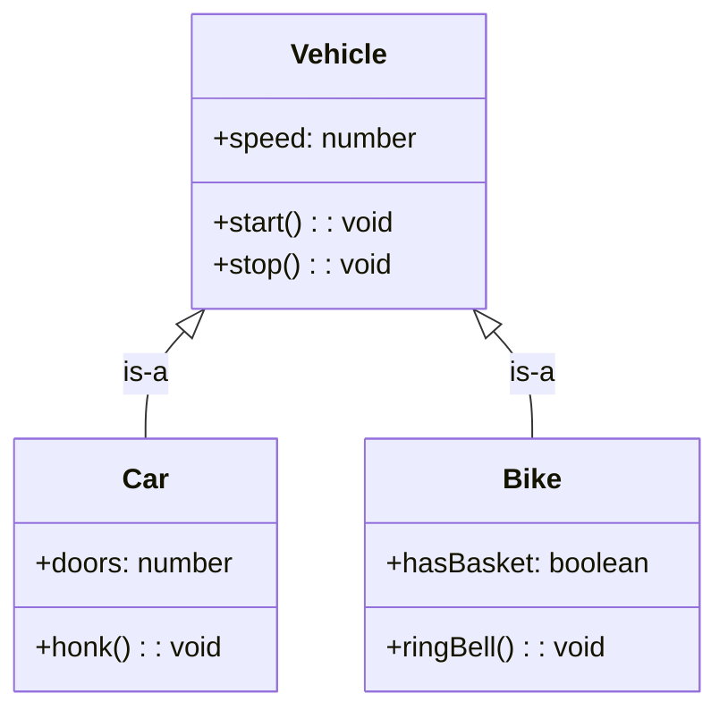
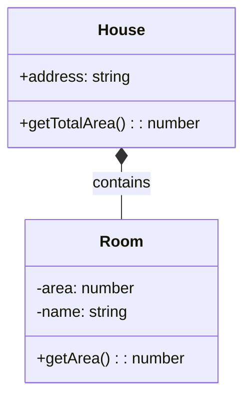
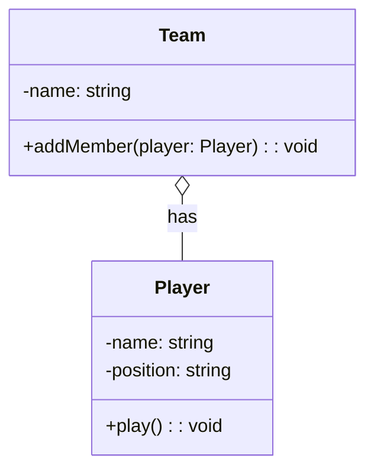
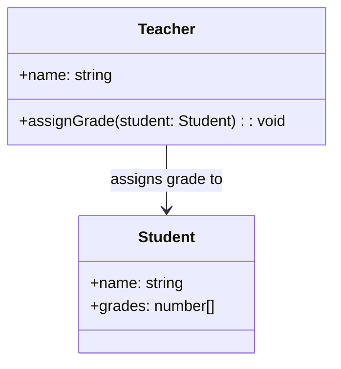
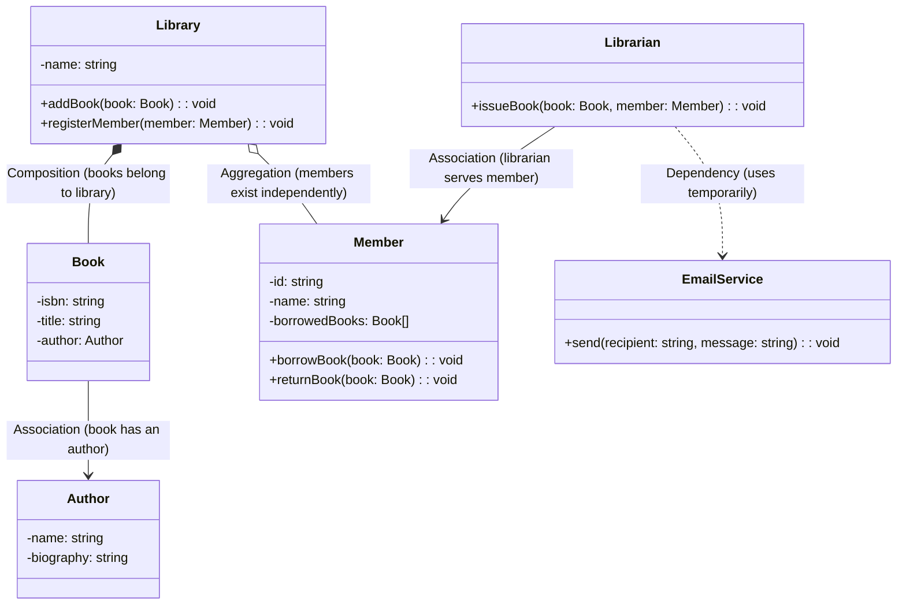

## 05 — Object Relationships

**Object relationships** define how classes interact with each other. Understanding the right relationship type is critical for clean LLD.

> **Analogy:** Object relationships are like different types of human connections. Inheritance is like a family tree (parent-child). Composition is like a body and its organs (inseparable). Aggregation is like a team and its players (separable). Association is like knowing someone's phone number (using them occasionally).

---

### Problem Statement

Using wrong relationships leads to:
- **Tight coupling** — changing one class breaks many others
- **Fragile hierarchies** — deep inheritance chains that collapse under changes
- **Memory leaks** — objects that can't be garbage collected due to ownership confusion
- **Rigid code** — hard to extend because relationship types are wrong

---

### Relationship Overview



---

### 1. Inheritance (is-a)



```typescript
// TypeScript — Inheritance
class Vehicle {
  constructor(public speed: number = 0) {}
  start(): void { console.log("Vehicle started"); }
  stop(): void { console.log("Vehicle stopped"); }
}

class Car extends Vehicle {
  constructor(public doors: number, speed: number = 0) {
    super(speed);
  }
  honk(): void { console.log("Beep!"); }
}
```

---

### 2. Composition (strong has-a)

**Part cannot exist without the whole.** The part is created and destroyed with the whole.



```typescript
// TypeScript — Composition
class Room {
  constructor(public name: string, public area: number) {}
}

class House {
  private rooms: Room[] = [];
  
  constructor(public address: string) {
    // Rooms are created with the house
    this.rooms.push(new Room("Living Room", 30));
    this.rooms.push(new Room("Bedroom", 20));
    this.rooms.push(new Room("Kitchen", 15));
    // Destroy house → destroy rooms automatically
  }
  
  getTotalArea(): number {
    return this.rooms.reduce((sum, r) => sum + r.area, 0);
  }
}
```

---

### 3. Aggregation (weak has-a)

**Part can exist without the whole.** The whole references parts that can exist independently.



```typescript
// TypeScript — Aggregation
class Player {
  constructor(public name: string, public position: string) {}
  play(): void { console.log(`${this.name} is playing`); }
}

class Team {
  private players: Player[] = [];
  
  constructor(public name: string) {}
  
  addMember(player: Player): void {
    this.players.push(player);
    // Player exists independently — can join another team later
  }
}

// Usage — players exist before and after the team
const messi = new Player("Messi", "Forward");
const team = new Team("Barcelona");
team.addMember(messi);
```

---

### 4. Association (uses)

**One class uses another.** The weakest relationship — temporary or permanent reference.



```typescript
// TypeScript — Association
class Student {
  public grades: number[] = [];
  constructor(public name: string) {}
}

class Teacher {
  constructor(public name: string) {}
  
  assignGrade(student: Student, grade: number): void {
    student.grades.push(grade);
    // Teacher only uses student temporarily
  }
}
```

---

### 5. Dependency (uses temporarily)

**A class uses another as a method parameter or return type.**

```typescript
// TypeScript — Dependency
class EmailService {
  sendEmail(to: string, message: string): void {
    console.log(`Sending to ${to}: ${message}`);
  }
}

class OrderService {
  // EmailService is a dependency — used only in this method
  confirmOrder(orderId: string, emailService: EmailService): void {
    // ... process order
    emailService.sendEmail("user@example.com", `Order ${orderId} confirmed`);
  }
}
```

---

### Complete Example — All Relationships



---

### Design Decisions

| Relationship | When to Use | Example |
|-------------|-------------|---------|
| **Inheritance** | Clear "is-a" relationship that won't change | Dog is-a Animal |
| **Composition** | Part cannot exist without whole, strong ownership | Car has Engine (engine destroyed with car) |
| **Aggregation** | Part can exist without whole, shared ownership | Team has Players (player can join another team) |
| **Association** | One class needs to know about another | Teacher knows Student |
| **Dependency** | Temporary use, method parameter | OrderService uses EmailService |

---

### Interview Questions

1. **What's the difference between composition and aggregation? Give examples.**
2. **When would you choose inheritance over composition?**
3. **How does understanding relationships help with garbage collection?**
4. **What's the difference between association and dependency?**
5. **Draw a class diagram showing all 5 relationship types.**

---

### In Simple Words

- **Inheritance** (is-a) = child inherits from parent class
- **Composition** (strong has-a) = part belongs to whole, can't exist without it (House → Room)
- **Aggregation** (weak has-a) = part can exist without whole (Team → Player)
- **Association** (uses) = one class knows about another (Teacher → Student)
- **Dependency** (temporary use) = method parameter or return type
- **Composition over inheritance** — prefer has-a relationships for flexibility
- The stronger the relationship, the more tightly coupled the classes are
