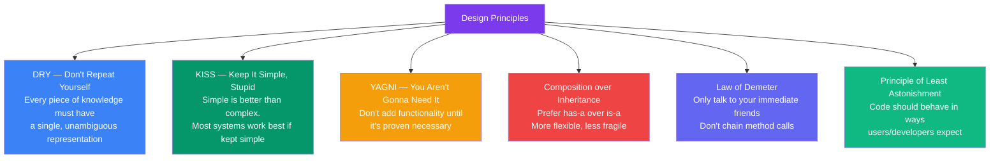

## 06 — Design Principles

Beyond SOLID, several other design principles help create clean, maintainable code. These principles guide everyday design decisions.

> **Analogy:** Design principles are like cooking rules of thumb. "Season as you go" (don't add all salt at once) isn't a rigid law, but following it makes better food. Similarly, design principles aren't laws — they're guidelines that experienced developers follow.

---

### Problem Statement

Ignoring design principles leads to:
- **Code bloat** — implementing features that are never used
- **Over-engineering** — complex solutions for simple problems
- **Brittle code** — changes in one place cascade everywhere
- **Duplication** — same logic copied across the codebase

---

### Principles Overview



---

### DRY — Don't Repeat Yourself

**Every piece of knowledge should have a single, unambiguous representation.**

```typescript
// ❌ Bad: Duplicated logic
function calculateCircleArea(radius: number): number {
  return 3.14159 * radius * radius;
}
function calculateCircleCircumference(radius: number): number {
  return 2 * 3.14159 * radius; // 3.14159 duplicated
}

// ✅ Good: Extract constant
const PI = 3.14159;

function calculateCircleArea(radius: number): number {
  return PI * radius * radius;
}
function calculateCircleCircumference(radius: number): number {
  return 2 * PI * radius;
}
```

---

### KISS — Keep It Simple, Stupid

**Simple is better than complex. Most systems work best if kept simple.**

```typescript
// ❌ Bad: Overly complex
function isEven(num: number): boolean {
  return num % 2 === 0 ? true : false; // Unnecessary ternary
}

// ✅ Good: Simple
function isEven(num: number): boolean {
  return num % 2 === 0;
}
```

---

### YAGNI — You Aren't Gonna Need It

**Don't add functionality until it's proven necessary.**

```typescript
// ❌ Bad: Building for hypothetical future needs
class WeatherService {
  constructor(private apiKey: string) {}
  
  getCurrentWeather(city: string): any {
    // Current requirement
  }
  
  // Hypothetical future features — DON'T BUILD YET
  getForecastWeek(city: string): any[] { /* ... */ }
  getHistoricalData(city: string, years: number): any[] { /* ... */ }
  compareCities(cities: string[]): any { /* ... */ }
  generateWeatherReport(city: string): string { /* ... */ }
}

// ✅ Good: Just what's needed now
class WeatherService {
  constructor(private apiKey: string) {}
  
  getCurrentWeather(city: string): any {
    // Current requirement — add more when (and if) needed
  }
}
```

---

### Composition over Inheritance

**Prefer object composition over class inheritance.**

```mermaid
classDiagram
    class InheritanceTree {
        <<BAD>>
    }
    class Animal { +eat() void }
    class Bird { +fly() void }
    class Penguin { +fly() void* }  // Can't fly!
    Animal <|-- Bird
    Bird <|-- Penguin

    class CompositionApproach {
        <<GOOD>>
    }
    class Animal_2 { +eat() void }
    class Flyable { <<interface>> +fly() void }
    class Bird_2 { +eat() void $~> +fly() void$ }
    class Penguin_2 { +eat() void }
    Animal_2 <|-- Bird_2
    Animal_2 <|-- Penguin_2
    Bird_2 ..|> Flyable
```

```typescript
// ❌ Bad: Deep inheritance
class Pizza {
  prepare(): void {}
  bake(): void {}
}

class CheesePizza extends Pizza {}
class PepperoniPizza extends Pizza {}
class VeggiePizza extends Pizza {}
// What if we want a Cheese + Pepperoni pizza? Can't!

// ✅ Good: Composition
interface Topping {
  getName(): string;
  getPrice(): number;
}

class Cheese implements Topping {
  getName(): string { return "Cheese"; }
  getPrice(): number { return 1.5; }
}

class Pepperoni implements Topping {
  getName(): string { return "Pepperoni"; }
  getPrice(): number { return 2.0; }
}

class Pizza {
  constructor(private toppings: Topping[]) {}
  addTopping(topping: Topping): void { this.toppings.push(topping); }
  getTotalPrice(): number {
    return this.toppings.reduce((sum, t) => sum + t.getPrice(), 0);
  }
}

// Now we can create any pizza combination!
const pizza = new Pizza([]);
pizza.addTopping(new Cheese());
pizza.addTopping(new Pepperoni());
```

---

### Law of Demeter (Principle of Least Knowledge)

**Only talk to your immediate friends — don't chain method calls.**

```typescript
// ❌ Bad: Violates Law of Demeter
class Customer {
  getWallet(): Wallet { return this.wallet; }
}

class Wallet {
  getBalance(): number { return this.balance; }
}

// Many dots = violation
const amount = customer.getWallet().getBalance();

// ✅ Good: Tell, don't ask
class Customer {
  private wallet: Wallet;
  
  getBalance(): number { return this.wallet.getBalance(); }
  canAfford(amount: number): boolean {
    return this.wallet.getBalance() >= amount;
  }
}

// Only one dot
const canAfford = customer.canAfford(100);
```

---

### Principle of Least Astonishment

**Code should behave in ways that users and developers expect.**

```typescript
// ❌ Bad: Astonishing behavior
class Counter {
  private value = 0;
  
  increment(): number { this.value += 1; return this.value; }
  reset(): number { this.value = 0; return this.value; }
  // Developer expects add(5) to add 5
  add(amount: number): number { this.value = amount; return this.value; } // Sets, not adds!
}

// ✅ Good: Expected behavior
class Counter {
  private value = 0;
  
  increment(): number { this.value += 1; return this.value; }
  add(amount: number): number { this.value += amount; return this.value; }
  reset(): void { this.value = 0; }
}
```

---

### Design Decisions

| Principle | When to Apply | When to Relax |
|-----------|--------------|---------------|
| **DRY** | Logic is repeated in 3+ places | One-time use, prototyping |
| **KISS** | Always — first solution should be simplest | Performance-critical code may need complexity |
| **YAGNI** | Before adding any feature | The feature is the next logical step and cheap to add now |
| **Composition** | When you need flexibility | When there's a clear, stable is-a hierarchy |
| **Law of Demeter** | Most method calls | Performance-sensitive code (e.g., game engines) |

---

### Interview Questions

1. **Explain DRY, KISS, and YAGNI with examples.**
2. **Why is composition preferred over inheritance in most cases?**
3. **What is the Law of Demeter and why is it important?**
4. **Have you ever violated YAGNI? What happened?**
5. **How do you balance DRY with readability?**

---

### In Simple Words

- **DRY** = don't copy-paste code — extract it once
- **KISS** = solve the problem simply; resist the urge to over-engineer
- **YAGNI** = don't build features for "someday" — build them when you need them
- **Composition > Inheritance** = has-a is more flexible than is-a
- **Law of Demeter** = one dot per line; don't chain deeply
- **Least Astonishment** = code should surprise no one
- These principles prevent **over-engineering, duplication, and fragile code**
