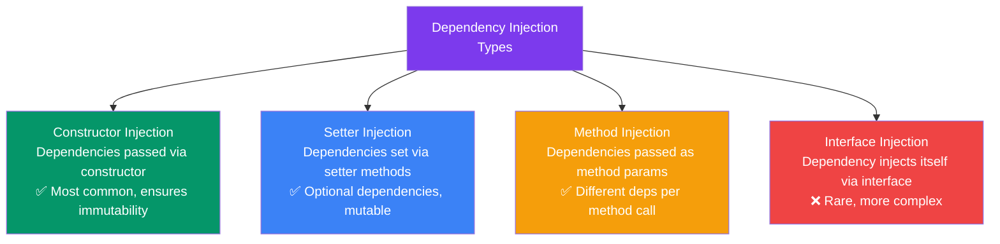
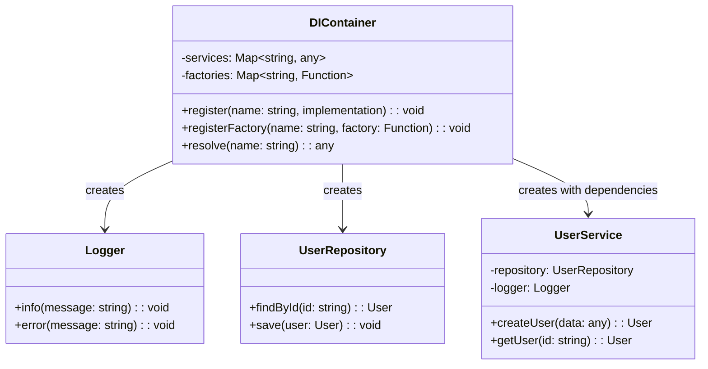

## 07 — Dependency Injection

**Dependency Injection (DI)** is a design pattern where objects receive their dependencies from an external source rather than creating them internally. It's a practical application of the Dependency Inversion Principle.

> **Analogy:** Dependency Injection is like a restaurant. The chef (class) doesn't grow their own vegetables or raise their own cows — ingredients (dependencies) are delivered by suppliers. If the chef needs different ingredients, you just change the supplier, not the chef.

---

### Problem Statement

Without DI:
- **Tight coupling** — classes create their own dependencies, can't be swapped
- **Hard to test** — can't mock dependencies in unit tests
- **Code duplication** — dependency creation logic scattered everywhere
- **Violates SRP** — classes handle both business logic and dependency creation

---

### DI Types



---

### 1. Constructor Injection (Recommended)

```typescript
// TypeScript — Constructor Injection
interface Database {
  save(entity: any): void;
  findById(id: string): any;
}

class MySQLDatabase implements Database {
  save(entity: any): void { /* MySQL save */ }
  findById(id: string): any { /* MySQL query */ }
}

class UserService {
  // Dependencies are clear from the constructor
  constructor(
    private database: Database,
    private emailService: EmailService,
    private logger: Logger
  ) {}
  
  async createUser(data: any): Promise<void> {
    this.logger.info("Creating user...");
    this.database.save(data);
    await this.emailService.sendWelcomeEmail(data.email);
  }
}

// Usage
const userService = new UserService(
  new MySQLDatabase(),
  new EmailService(),
  new ConsoleLogger()
);
```

---

### 2. Setter Injection

```typescript
// TypeScript — Setter Injection
class PaymentProcessor {
  private paymentGateway?: PaymentGateway;
  private fraudDetector?: FraudDetector;
  
  // Mandatory dependency
  constructor(private orderService: OrderService) {}
  
  // Optional dependencies via setters
  setPaymentGateway(gateway: PaymentGateway): void {
    this.paymentGateway = gateway;
  }
  
  setFraudDetector(detector: FraudDetector): void {
    this.fraudDetector = detector;
  }
  
  processPayment(order: Order): void {
    if (this.fraudDetector) {
      this.fraudDetector.check(order);
    }
    // Process with or without fraud detection
  }
}
```

---

### 3. Method Injection

```typescript
// TypeScript — Method Injection
class ReportGenerator {
  generateReport(data: any[], formatter: ReportFormatter): string {
    // formatter is injected per method call
    return formatter.format(data);
  }
}

// Different formatters can be used for different calls
const generator = new ReportGenerator();
const csv = generator.generateReport(data, new CSVFormatter());
const json = generator.generateReport(data, new JSONFormatter());
const pdf = generator.generateReport(data, new PDFFormatter());
```

---

### DI Container Example



```typescript
// Simple DI container in TypeScript
class DIContainer {
  private services = new Map<string, any>();
  private factories = new Map<string, (c: DIContainer) => any>();
  
  register<T>(name: string, implementation: T): void {
    this.services.set(name, implementation);
  }
  
  registerFactory<T>(name: string, factory: (container: DIContainer) => T): void {
    this.factories.set(name, factory);
  }
  
  resolve<T>(name: string): T {
    // Check for existing instance
    if (this.services.has(name)) {
      return this.services.get(name);
    }
    // Check for factory
    if (this.factories.has(name)) {
      const instance = this.factories.get(name)!(this);
      this.services.set(name, instance);
      return instance;
    }
    throw new Error(`Service ${name} not registered`);
  }
}

// Usage
const container = new DIContainer();

container.register("logger", new ConsoleLogger());
container.registerFactory("userRepository", (c) => new UserRepository(c.resolve("logger")));
container.registerFactory("userService", (c) => 
  new UserService(c.resolve("userRepository"), c.resolve("logger"))
);

const userService = container.resolve<UserService>("userService");
```

---

### DI Benefits

| Benefit | Without DI | With DI |
|---------|-----------|---------|
| **Testability** | Can't mock database — tests hit real DB | Inject mock database for unit tests |
| **Flexibility** | Hard-coded dependencies | Swap implementations easily |
| **Reusability** | Tightly coupled classes | Decoupled, reusable components |
| **Clarity** | Dependencies hidden inside methods | Dependencies visible in constructor |

---

### Design Decisions

| Aspect | Recommendation |
|--------|---------------|
| **Preferred method** | Constructor injection — makes dependencies explicit and immutable |
| **Use DI container** | For medium-to-large applications (NestJS has built-in DI) |
| **Avoid service locator** | It hides dependencies (like global state) |
| **Testing** | DI makes mocking trivial — pass mocks in tests |

---

### Interview Questions

1. **What is Dependency Injection and why is it useful?**
2. **What are the different types of dependency injection?**
3. **How does DI improve testability?**
4. **What's the difference between a DI container and a service locator?**
5. **How does DI relate to the Dependency Inversion Principle?**

---

### In Simple Words

- **DI** = classes receive their dependencies from outside, not creating them internally
- **Constructor injection** is the most common and recommended approach
- **DI enables testing** — you can inject mock objects instead of real implementations
- **DI containers** automate dependency wiring (NestJS, Angular, Spring have built-in DI)
- Without DI, classes are **tightly coupled** and **hard to test**
- DI is the practical implementation of the **Dependency Inversion Principle**
