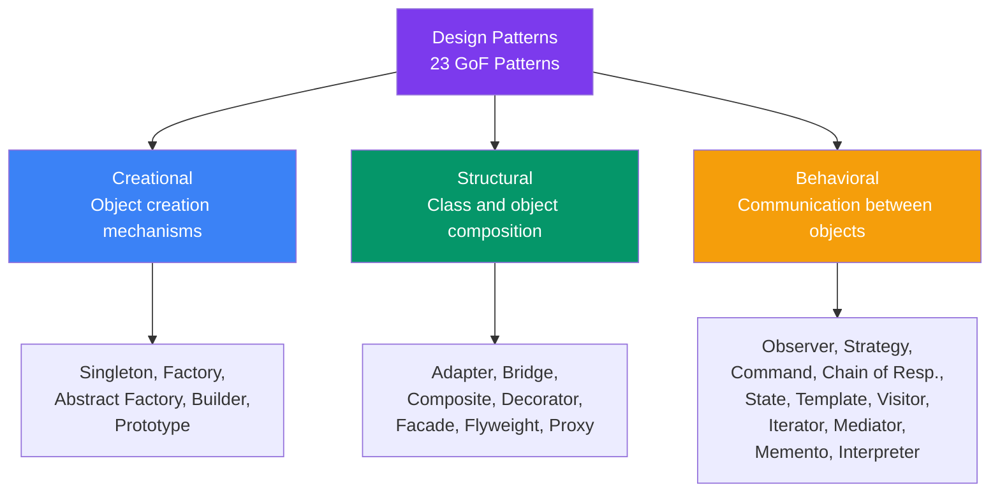
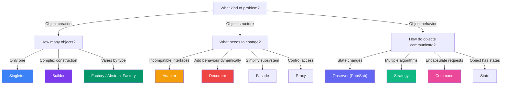

## 08 — Design Pattern Selection

**Design patterns** are reusable solutions to common problems in software design. They're not code you copy-paste, but templates for solving problems.

> **Analogy:** Design patterns are like chess openings. You don't invent a new response to e4 every time — you learn established patterns (Sicilian Defense, Italian Game) and adapt them to the specific situation.

---

### Problem Statement

Choosing the wrong pattern — or using patterns unnecessarily — leads to:
- **Over-engineering** — adding complexity where a simple solution would work
- **Wrong abstraction level** — patterns for problems they don't solve
- **Patternitis** — forcing patterns everywhere because they're "best practice"
- **Maintenance burden** — complex patterns are harder to understand

---

### Pattern Categories



---

### When to Use Each Pattern

| Category | Pattern | Problem It Solves | When to Use |
|----------|---------|-------------------|-------------|
| **Creational** | **Singleton** | Only one instance needed | Config, logging, thread pools |
| **Creational** | **Factory** | Object creation logic is complex | Creating objects based on dynamic type |
| **Creational** | **Builder** | Object has many optional parts | Building complex objects step by step |
| **Structural** | **Adapter** | Incompatible interfaces | Integrating third-party code |
| **Structural** | **Decorator** | Adding behavior dynamically | Adding features without changing class |
| **Structural** | **Facade** | Complex subsystem | Simplifying a complex API |
| **Behavioral** | **Observer** | One-to-many notification | Event handling, pub/sub |
| **Behavioral** | **Strategy** | Multiple algorithms | Sorting, payment methods |
| **Behavioral** | **Command** | Encapsulating requests | Undo/redo, task queues |

---

### Design Pattern Decision Tree



---

### Quick Examples

**Strategy Pattern** — Payment methods

```typescript
interface PaymentStrategy {
  pay(amount: number): void;
}

class CreditCardPayment implements PaymentStrategy {
  pay(amount: number): void { console.log(`Paid $${amount} via Card`); }
}

class PayPalPayment implements PaymentStrategy {
  pay(amount: number): void { console.log(`Paid $${amount} via PayPal`); }
}

class Checkout {
  constructor(private strategy: PaymentStrategy) {}
  execute(amount: number): void { this.strategy.pay(amount); }
}
```

**Observer Pattern** — Event system

```typescript
interface Observer {
  update(event: string, data: any): void;
}

class EventBus {
  private observers: Map<string, Observer[]> = new Map();
  
  subscribe(event: string, observer: Observer): void {
    if (!this.observers.has(event)) this.observers.set(event, []);
    this.observers.get(event)!.push(observer);
  }
  
  publish(event: string, data: any): void {
    this.observers.get(event)?.forEach(o => o.update(event, data));
  }
}
```

---

### Anti-Patterns to Avoid

| Anti-Pattern | Problem | Better Approach |
|--------------|---------|-----------------|
| **God Object** | One class does everything | Split into focused classes (SRP) |
| **Spaghetti Code** | No clear structure | Use patterns to organize |
| **Golden Hammer** | Using favorite pattern for every problem | Choose pattern based on problem |
| **Copy-Paste Programming** | Duplicated code | Extract common logic (DRY) |

---

### Interview Questions

1. **How do you decide which design pattern to use?**
2. **What's the difference between Strategy and State patterns?**
3. **When would you use Factory vs Abstract Factory?**
4. **What's the difference between Decorator and Proxy?**
5. **Have you ever used a pattern where it wasn't needed? What happened?**

---

### In Simple Words

- **Creational patterns** = how objects are created (Singleton, Factory, Builder)
- **Structural patterns** = how classes/objects are composed (Adapter, Decorator, Facade)
- **Behavioral patterns** = how objects communicate (Observer, Strategy, Command)
- Don't force patterns — let the **problem dictate the pattern**
- **Strategy** = swap algorithms at runtime (like choosing payment method)
- **Observer** = one-to-many notifications (like event listeners)
- **Factory** = let subclasses decide which objects to create
- **Patterns are tools, not rules** — sometimes a simple if-else is better than a pattern
