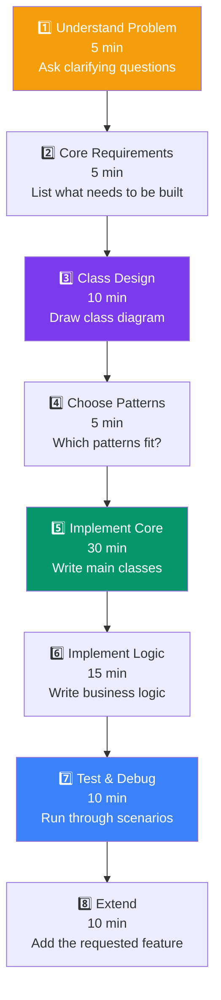
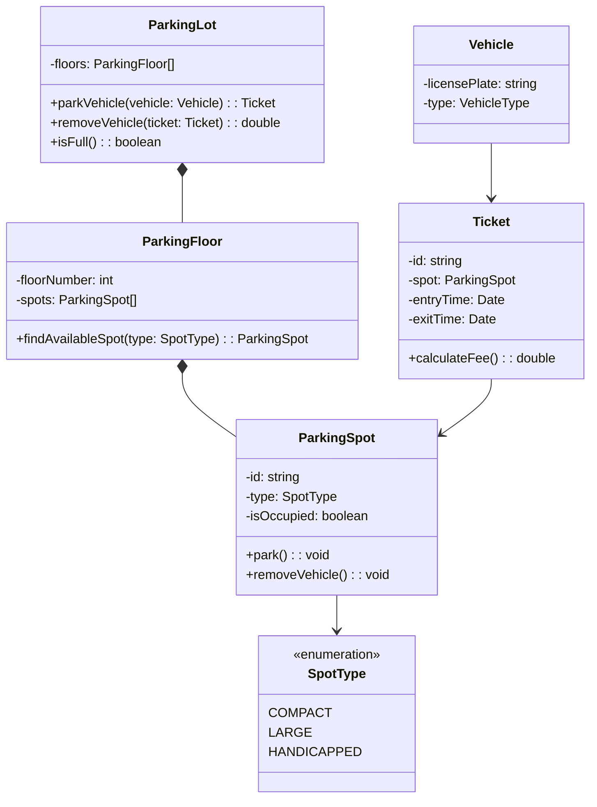

## 09 — Machine Coding Approach

**Machine coding** is a type of interview where you design and code a complete system in 60-90 minutes. It tests your LLD skills, coding ability, and design thinking under time pressure.

> **Analogy:** Machine coding is like cooking a complex dish in a timed competition. You need to plan your approach, prep ingredients (design classes), cook efficiently (implement), and plate nicely (organize code) — all within the time limit.

---

### Problem Statement

Machine coding is challenging because:
- **Time pressure** — 60-90 minutes to design + code a complete system
- **No overspec** — you must clarify requirements yourself
- **Working code expected** — not just design, but runnable implementation
- **Edge cases** — interviewers will test with unusual inputs
- **Extensions** — interviewers will ask you to add features on the fly

---

### Step-by-Step Approach



---

### Detailed Breakdown

**Step 1: Understand the Problem (5 min)**

Ask clarifying questions:
- What are the core entities?
- What actions can users perform?
- Are there any constraints (max capacity, time limits)?
- Should I handle edge cases like duplicate entries?

**Step 2: Core Requirements (5 min)**

List everything the system must do:
```
Parking Lot System:
- Multiple floors, multiple spots per floor
- Different spot types (compact, large, handicapped)
- Park vehicle, remove vehicle
- Track available spots by type
- Calculate parking fee
- Generate ticket on entry
```

**Step 3: Class Design (10 min)**

Draw the class diagram:



**Step 4: Choose Patterns (5 min)**

| Pattern | Where to Use | Why |
|---------|--------------|-----|
| **Factory** | Create parking spots by type | Encapsulate spot creation logic |
| **Strategy** | Fee calculation (different rates) | Swap fee calculation algorithm |
| **Singleton** | ParkingLot (single instance) | Only one parking lot per system |

**Step 5-6: Implementation (45 min)**

```typescript
// Core implementation structure
enum SpotType { COMPACT, LARGE, HANDICAPPED }
enum VehicleType { MOTORCYCLE, CAR, TRUCK }

class ParkingSpot {
  constructor(
    public id: string,
    public type: SpotType,
    public isOccupied: boolean = false
  ) {}
  
  park(): void { this.isOccupied = true; }
  removeVehicle(): void { this.isOccupied = false; }
}

class ParkingFloor {
  private spots: ParkingSpot[] = [];
  
  constructor(public floorNumber: number) {}
  
  addSpot(spot: ParkingSpot): void { this.spots.push(spot); }
  
  findAvailableSpot(type: SpotType): ParkingSpot | null {
    return this.spots.find(s => s.type === type && !s.isOccupied) || null;
  }
}

class ParkingLot {
  private static instance: ParkingLot;
  private floors: ParkingFloor[] = [];
  
  static getInstance(): ParkingLot {
    if (!this.instance) this.instance = new ParkingLot();
    return this.instance;
  }
  
  addFloor(floor: ParkingFloor): void { this.floors.push(floor); }
  
  parkVehicle(type: SpotType): Ticket | null {
    for (const floor of this.floors) {
      const spot = floor.findAvailableSpot(type);
      if (spot) {
        spot.park();
        return new Ticket(spot);
      }
    }
    return null; // No spot available
  }
  
  removeVehicle(ticket: Ticket): number {
    ticket.spot.removeVehicle();
    ticket.exitTime = new Date();
    return ticket.calculateFee();
  }
}
```

**Step 7: Test & Debug (10 min)**

```typescript
// Test scenarios
const lot = ParkingLot.getInstance();
const floor1 = new ParkingFloor(1);
floor1.addSpot(new ParkingSpot("A1", SpotType.COMPACT));
floor1.addSpot(new ParkingSpot("A2", SpotType.LARGE));
lot.addFloor(floor1);

// Park a car
const ticket = lot.parkVehicle(SpotType.COMPACT);
console.log(ticket ? `Parked at ${ticket.spot.id}` : "No spots available");

// Remove vehicle
const fee = lot.removeVehicle(ticket!);
console.log(`Fee: $${fee}`);
```

---

### Common Mistakes

| Mistake | Why It's Bad | Better Approach |
|---------|--------------|-----------------|
| **Starting to code immediately** | Miss design flaws | Draw class diagram first |
| **Too many classes** | Over-engineered, run out of time | Start simple, add later |
| **No error handling** | Crashes on edge cases | Handle null, invalid input |
| **Hard-coded values** | Can't change or extend | Use constants, config |
| **No testing** | Hidden bugs | Walk through scenarios verbally |

---

### Time Management

| Phase | Time | Deliverable |
|-------|------|-------------|
| **Understanding** | 5 min | Clear requirements list |
| **Design** | 10-15 min | Class diagram (on paper/whiteboard) |
| **Implementation** | 30-40 min | Working code |
| **Testing** | 10 min | Correct output for test cases |
| **Extension** | 10 min | Feature addition requested by interviewer |

---

### Interview Questions (for this approach)

1. **Walk through your approach to a machine coding problem.**
2. **How do you decide what to implement vs what to defer?**
3. **How do you handle time pressure during a machine coding round?**
4. **What's the most important part — design or implementation?**
5. **How do you add a new feature without breaking existing code?**

---

### In Simple Words

- **Machine coding** = 60-90 min to design + implement a complete system
- **Always design first** — draw class diagram before writing code
- **Start simple** — implement core functionality first, add features second
- **Talk through your thinking** — interviewers want to see your process
- **Handle edge cases** — null checks, invalid inputs, boundary conditions
- **DRY but not too DRY** — extract duplication but don't over-abstract
- Practice with the 15 projects in this section — they cover common machine coding problems
