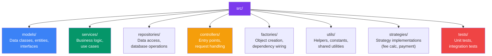
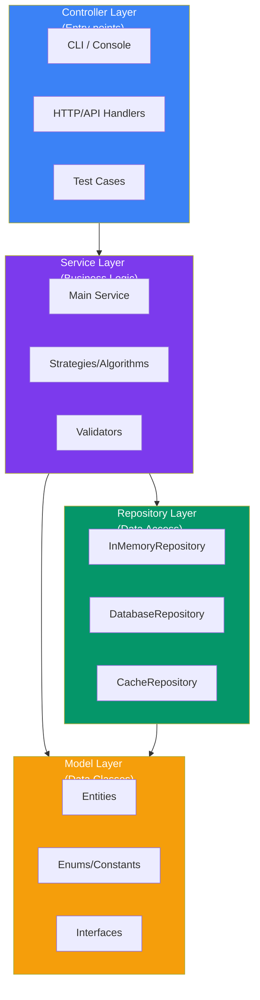

## 10 — Code Organization

**Code organization** is how you structure your codebase — packages, modules, naming, and layering. Good organization makes code easy to find, understand, and maintain.

> **Analogy:** Code organization is like organizing a kitchen. If every utensil has a designated drawer (package), ingredients are labeled (names), and the workflow from prep to cooking to plating is clear (layers), cooking is efficient. A messy kitchen (unorganized code) wastes time and causes mistakes.

---

### Problem Statement

Poor code organization leads to:
- **Where is this code?** — developers waste time finding files
- **What does this do?** — unclear naming and responsibilities
- **Where should this go?** — new features added to random files
- **Merge conflicts** — multiple developers editing the same files
- **Onboarding nightmare** — new team members can't navigate the codebase

---

### Project Structure



---

### Layered Architecture



---

### File Naming Conventions

| Convention | Example | When to Use |
|------------|---------|-------------|
| **PascalCase for classes** | `ParkingLot.ts`, `UserService.ts` | Classes, interfaces, types |
| **camelCase for methods/vars** | `parkVehicle()`, `isAvailable` | Methods, variables, properties |
| **kebab-case for files** | `parking-lot.ts`, `user-service.ts` | File names (TypeScript convention) |
| **UPPER_CASE for constants** | `MAX_CAPACITY`, `HOURLY_RATE` | Global constants, enums |
| **I prefix for interfaces** | `IRepository`, `IPaymentStrategy` | Interfaces (TypeScript convention) |

---

### Package Structure Example (Parking Lot)

```
src/
├── models/
│   ├── parking-spot.ts
│   ├── vehicle.ts
│   ├── ticket.ts
│   └── enums.ts              # SpotType, VehicleType, PaymentStatus
├── services/
│   ├── parking-lot-service.ts
│   ├── fee-calculator.ts
│   └── payment-processor.ts
├── strategies/
│   ├── fee-calculation-strategy.ts
│   ├── hourly-fee-strategy.ts
│   └── daily-fee-strategy.ts
├── repositories/
│   ├── parking-spot-repository.ts
│   └── ticket-repository.ts
├── utils/
│   ├── id-generator.ts
│   └── date-utils.ts
├── index.ts                   # Entry point + dependency wiring
└── tests/
    ├── parking-lot.test.ts
    └── fee-calculator.test.ts
```

---

### Clean Architecture Layers

| Layer | Responsibility | Depends On | Example |
|-------|---------------|------------|---------|
| **Entity** | Business rules | Nothing | `User`, `Order`, `Product` |
| **Use Case** | Application-specific rules | Entities | `CreateOrderUseCase` |
| **Interface Adapter** | Convert data formats | Use Cases | `Controller`, `Presenter` |
| **Framework** | External tools | Interface Adapters | Express, React, MongoDB |

```typescript
// Entity — pure business logic
class Order {
  constructor(public items: OrderItem[]) {}
  
  getTotal(): number {
    return this.items.reduce((sum, i) => sum + i.price * i.quantity, 0);
  }
}

// Use Case — application logic
class CreateOrderUseCase {
  constructor(private orderRepo: OrderRepository) {}
  
  async execute(userId: string, items: OrderItem[]): Promise<Order> {
    const order = new Order(items);
    if (order.getTotal() <= 0) throw new Error("Order must have items");
    return this.orderRepo.save(order);
  }
}
```

---

### Best Practices

| Practice | Why |
|----------|-----|
| **One class per file** | Easy to find, version control friendly |
| **Package by feature** | Related classes together (not by layer) |
| **Avoid circular dependencies** | A depends on B, B depends on A → refactor |
| **Keep packages small** | < 10 files per package, or split |
| **Interface in same package as consumer** | Keeps dependency direction clear |
| **Test file next to source** | `user-service.ts` → `user-service.test.ts` |

---

### Interview Questions

1. **How do you structure a typical LLD project?**
2. **What's the difference between package by layer vs package by feature?**
3. **How do you handle circular dependencies?**
4. **What naming conventions do you use and why?**
5. **How would you organize a project with 100+ classes?**

---

### In Simple Words

- **Separate concerns** — models, services, repositories, controllers in different folders
- **One class per file** — makes the codebase easy to navigate
- **Layered architecture** — Controller → Service → Repository → Model
- **Package by feature** — group related files together (e.g., all payment-related files in one folder)
- **Naming conventions** — PascalCase for classes, camelCase for methods, kebab-case for files
- **Interface in the consumer's package** — not in the implementer's package
- **Good organization** makes code **navigable, maintainable, and scalable** — invest time in it
