# Low-Level Design (LLD)

**Low-Level Design (LLD)** is the detailed design phase where system components are broken down into classes, interfaces, and methods. It focuses on **how** to implement the architecture defined in HLD using object-oriented principles and design patterns.

> **Analogy:** If HLD is the architectural blueprint of a building, LLD is the detailed plan for each room — where every outlet, switch, and pipe goes. It's the design that contractors (developers) can directly build from.

---

## Learning Path

```mermaid
flowchart LR
    OOP["01 OOP<br/>Fundamentals"] --> SOLID["02 SOLID<br/>Principles"]
    SOLID --> UML["03 UML<br/>Basics"]
    UML --> CD["04 Class<br/>Diagrams"]
    CD --> OR["05 Object<br/>Relationships"]
    OR --> DP["06 Design<br/>Principles"]
    DP --> DI["07 Dependency<br/>Injection"]
    DI --> DPS["08 Design Pattern<br/>Selection"]
    DPS --> MCA["09 Machine Coding<br/>Approach"]
    MCA --> CO["10 Code<br/>Organization"]

    style OOP fill:#7c3aed,color:#fff
    style SOLID fill:#4f46e5,color:#fff
    style CD fill:#059669,color:#fff
    style DP fill:#f59e0b,color:#fff
    style MCA fill:#ef4444,color:#fff
    style CO fill:#6366f1,color:#fff
```

---

## Sections Overview

| # | Topic | What You'll Learn |
|---|-------|-------------------|
| 01 | OOP Fundamentals | Classes, objects, encapsulation, inheritance, polymorphism, abstraction |
| 02 | SOLID Principles | Single Responsibility, Open-Closed, Liskov Substitution, Interface Segregation, Dependency Inversion |
| 03 | UML Basics | Unified Modeling Language, diagrams, notation, relationships |
| 04 | Class Diagrams | Attributes, methods, visibility, inheritance, interfaces, abstract classes |
| 05 | Object Relationships | Association, aggregation, composition, inheritance, dependency |
| 06 | Design Principles | DRY, KISS, YAGNI, Composition over Inheritance, Law of Demeter |
| 07 | Dependency Injection | Constructor injection, setter injection, interface injection, containers |
| 08 | Design Pattern Selection | When to use creational, structural, behavioral patterns |
| 09 | Machine Coding Approach | Step-by-step approach to solving machine coding problems |
| 10 | Code Organization | Package structure, naming conventions, project layout |

---

## LLD Projects (15 Designs)

Each project follows a consistent template: **Problem → Requirements → Class Design → Mermaid Class Diagram → Design Decisions → Design Patterns → JS Example → TS Example → Interview Questions**.

| # | Project | Key Concepts |
|---|---------|--------------|
| 1 | Parking Lot | Multilevel parking, vehicle types, spot allocation, pricing |
| 2 | ATM | Cash withdrawal, deposit, balance inquiry, authentication |
| 3 | BookMyShow | Movie listing, seat selection, booking, payment |
| 4 | Library Management | Book catalog, members, borrowing, fines |
| 5 | Hotel Management | Rooms, reservations, check-in/out, billing |
| 6 | Elevator System | Multiple elevators, scheduling, floor requests |
| 7 | Vending Machine | Products, inventory, payment, change |
| 8 | Splitwise | Group expenses, splits, settlements, balances |
| 9 | Chess Game | Board, pieces, moves, check/checkmate validation |
| 10 | Snake & Ladder | Board, dice, players, snakes, ladders |
| 11 | Tic Tac Toe | Board, players, win detection, AI opponent |
| 12 | Logging Framework | Log levels, appenders, formatting, configuration |
| 13 | Notification Service | Multiple channels, templates, delivery, scheduling |
| 14 | Rate Limiter | Token bucket, sliding window, per-user limits |
| 15 | Cache System | LRU/LFU eviction, TTL, concurrent access |

---

## How This Track Works

- Each topic page follows a consistent template: **Problem → Requirements → Class Design → Mermaid Class Diagram → Design Decisions → Patterns Used → JS/TS Examples → Interview Questions**
- **Mermaid class diagrams** illustrate all relationships
- **JavaScript + TypeScript examples** show real implementation
- **Projects** apply all concepts to practical machine coding problems

Start with **[01 — OOP Fundamentals](./01-oop-fundamentals)** to begin!
