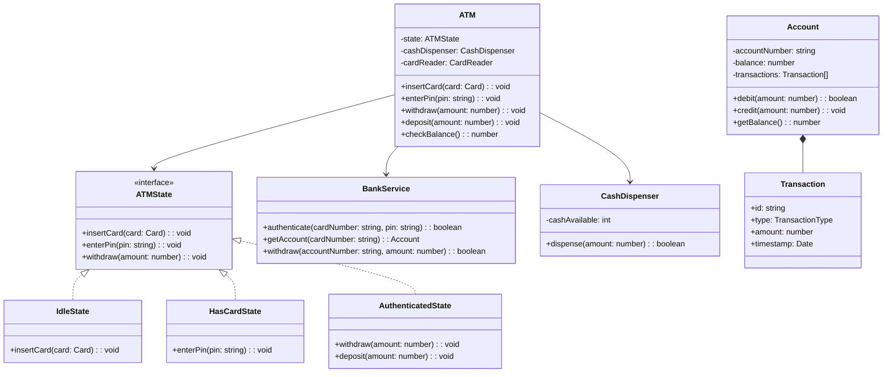

## Project 2 — Design ATM

**Problem:** Design an ATM machine that handles user authentication, cash withdrawal, deposit, balance inquiry, and transaction history.

---

### Requirements

| Requirement | Details |
|-------------|---------|
| Authentication | Card + PIN verification |
| Withdraw | Dispense cash if sufficient balance |
| Deposit | Accept cash/check, update balance |
| Balance inquiry | Show current account balance |
| Transaction history | Show recent transactions |

---

### Class Design



---

### Design Patterns Used

| Pattern | Where | Why |
|---------|-------|-----|
| **State** | ATM states (Idle, HasCard, Authenticated) | Clean state transitions |
| **Singleton** | ATM instance | One ATM machine |
| **Facade** | BankService | Simplifies complex bank operations |

---

### TypeScript Example

```typescript
enum TransactionType { WITHDRAWAL, DEPOSIT, BALANCE_CHECK }

class Account {
  private transactions: Transaction[] = [];
  
  constructor(public accountNumber: string, private balance: number = 0) {}
  
  debit(amount: number): boolean {
    if (this.balance < amount) return false;
    this.balance -= amount;
    this.transactions.push(new Transaction(TransactionType.WITHDRAWAL, amount));
    return true;
  }
  
  credit(amount: number): void {
    this.balance += amount;
    this.transactions.push(new Transaction(TransactionType.DEPOSIT, amount));
  }
  
  getBalance(): number { return this.balance; }
}

interface ATMState {
  insertCard(card: Card): void;
  enterPin(pin: string): void;
  withdraw(amount: number): void;
  deposit(amount: number): void;
}

class IdleState implements ATMState {
  constructor(private atm: ATM) {}
  insertCard(card: Card): void { this.atm.setState(new HasCardState(this.atm)); }
  enterPin(pin: string): void { throw new Error("Insert card first"); }
  withdraw(amount: number): void { throw new Error("Authenticate first"); }
  deposit(amount: number): void { throw new Error("Authenticate first"); }
}

class ATM {
  private state: ATMState = new IdleState(this);
  private currentAccount?: Account;
  
  constructor(private bankService: BankService) {}
  
  setState(state: ATMState): void { this.state = state; }
  insertCard(card: Card): void { this.state.insertCard(card); }
  enterPin(pin: string): void { this.state.enterPin(pin); }
  withdraw(amount: number): void { this.state.withdraw(amount); }
}
```

---

### Interview Questions

1. **How would you handle running out of cash?**
2. **How do you ensure transaction consistency?**
3. **What happens if the machine loses power during a transaction?**
4. **How would you add support for multiple currencies?**
