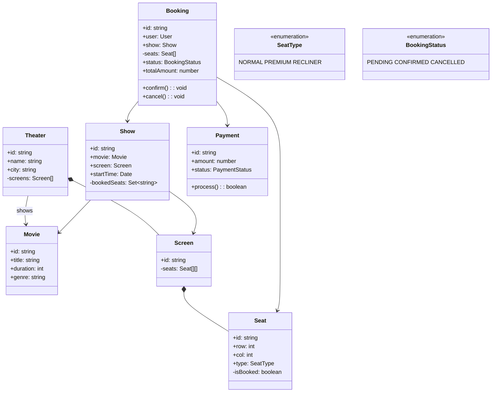

## Project 3 — Design BookMyShow

**Problem:** Design a movie ticket booking platform where users can browse movies, select seats, and book tickets.

---

### Requirements

| Requirement | Details |
|-------------|---------|
| Browse movies | List movies by city, theater, date |
| Seat selection | View available seats, select seats |
| Booking | Reserve seats for 10 minutes, confirm |
| Payment | Process payment, confirm booking |
| Cancellation | Cancel booking, process refund |

---

### Class Design



---

### Design Patterns Used

| Pattern | Where | Why |
|---------|-------|-----|
| **Singleton** | BookingManager | Central booking coordination |
| **State** | Booking states (Pending, Confirmed, Cancelled) | Handle transitions |
| **Factory** | Seat creation | Create different seat types |

---

### JavaScript Example

```javascript
class Seat {
  constructor(id, row, col, type) {
    this.id = id;
    this.row = row;
    this.col = col;
    this.type = type; // 'NORMAL', 'PREMIUM', 'RECLINER'
    this.isBooked = false;
  }
}

class Show {
  constructor(id, movie, screen, startTime) {
    this.id = id;
    this.movie = movie;
    this.screen = screen;
    this.startTime = startTime;
    this.bookedSeats = new Set();
  }
  
  getAvailableSeats() {
    return this.screen.seats
      .flat()
      .filter(seat => !this.bookedSeats.has(seat.id));
  }
  
  bookSeats(seats) {
    for (const seat of seats) {
      if (this.bookedSeats.has(seat.id)) return false; // Already booked
      this.bookedSeats.add(seat.id);
    }
    return true;
  }
}

class Booking {
  constructor(user, show, seats) {
    this.id = Math.random().toString(36).substr(2, 9);
    this.user = user;
    this.show = show;
    this.seats = seats;
    this.status = 'PENDING';
    this.totalAmount = seats.reduce((sum, s) => {
      const prices = { NORMAL: 10, PREMIUM: 15, RECLINER: 25 };
      return sum + (prices[s.type] || 10);
    }, 0);
    this.createdAt = new Date();
  }
  
  confirm() {
    this.status = 'CONFIRMED';
    // Process payment
    return true;
  }
  
  cancel() {
    this.status = 'CANCELLED';
    // Release seats
    for (const seat of this.seats) {
      this.show.bookedSeats.delete(seat.id);
    }
    // Process refund
  }
}
```

---

### Interview Questions

1. **How do you handle seat locking (prevent double booking)?**
2. **How would you implement dynamic pricing?**
3. **How do you handle booking expiration (10-min hold)?**
4. **How would you add food/beverage ordering?**
