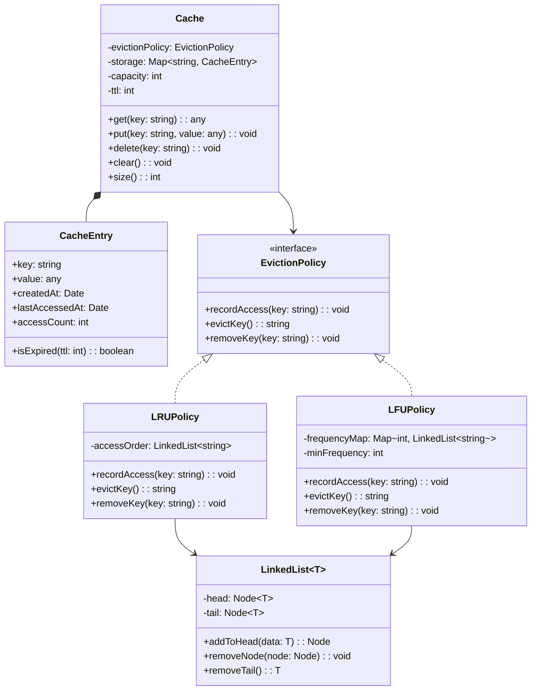

## Project 15 — Design Cache System

**Problem:** Design an in-memory cache system supporting multiple eviction policies (LRU, LFU), TTL, and concurrent access.

---

### Requirements

| Requirement | Details |
|-------------|---------|
| Storage | Key-value store in memory |
| Eviction | LRU (Least Recently Used), LFU (Least Frequently Used) |
| TTL | Time-to-live per key, auto-expire |
| Operations | get(key), put(key, value), delete(key), clear() |
| Capacity | Max entries, evict when full |
| Thread-safety | Support concurrent access |

---

### Class Design



---

### Design Patterns Used

| Pattern | Where | Why |
|---------|-------|-----|
| **Strategy** | Eviction policy | Swap LRU/LFU without changing cache |
| **Factory** | Cache creation | Create cache with configured policy |

---

### TypeScript Example

```typescript
// Doubly linked list node
class ListNode<K> {
  constructor(
    public key: K,
    public prev: ListNode<K> | null = null,
    public next: ListNode<K> | null = null
  ) {}
}

// Doubly linked list for O(1) operations
class DoublyLinkedList<K> {
  private head: ListNode<K> | null = null;
  private tail: ListNode<K> | null = null;
  
  addToFront(key: K): ListNode<K> {
    const node = new ListNode(key);
    if (!this.head) {
      this.head = this.tail = node;
    } else {
      node.next = this.head;
      this.head.prev = node;
      this.head = node;
    }
    return node;
  }
  
  removeNode(node: ListNode<K>): void {
    if (node.prev) node.prev.next = node.next;
    if (node.next) node.next.prev = node.prev;
    if (this.head === node) this.head = node.next;
    if (this.tail === node) this.tail = node.prev;
  }
  
  removeTail(): K | null {
    if (!this.tail) return null;
    const key = this.tail.key;
    this.removeNode(this.tail);
    return key;
  }
}

// LRU Eviction Policy
class LRUPolicy<K> implements EvictionPolicy<K> {
  private list = new DoublyLinkedList<K>();
  private nodes = new Map<K, ListNode<K>>();
  private maxSize: number;
  
  constructor(maxSize: number) { this.maxSize = maxSize; }
  
  recordAccess(key: K): void {
    const node = this.nodes.get(key);
    if (node) this.list.removeNode(node);
    this.nodes.set(key, this.list.addToFront(key));
  }
  
  evictKey(): K | null {
    const key = this.list.removeTail();
    if (key) this.nodes.delete(key);
    return key;
  }
  
  removeKey(key: K): void {
    const node = this.nodes.get(key);
    if (node) this.list.removeNode(node);
    this.nodes.delete(key);
  }
}

// CacheEntry
class CacheEntry<V> {
  constructor(
    public value: V,
    public createdAt: number = Date.now(),
    public lastAccessedAt: number = Date.now(),
    public accessCount: number = 1
  ) {}
}

// Cache
class Cache<K, V> {
  private storage = new Map<K, CacheEntry<V>>();
  private defaultTTL: number;
  
  constructor(
    private capacity: number,
    private evictionPolicy: EvictionPolicy<K>,
    defaultTTLMs: number = 60000
  ) {
    this.defaultTTL = defaultTTLMs;
  }
  
  get(key: K): V | null {
    const entry = this.storage.get(key);
    if (!entry) return null;
    
    // Check TTL
    if (Date.now() - entry.createdAt > this.defaultTTL) {
      this.delete(key);
      return null;
    }
    
    entry.lastAccessedAt = Date.now();
    entry.accessCount++;
    this.evictionPolicy.recordAccess(key);
    
    return entry.value;
  }
  
  put(key: K, value: V): void {
    if (this.storage.has(key)) {
      // Update existing
      const entry = this.storage.get(key)!;
      entry.value = value;
      entry.lastAccessedAt = Date.now();
      entry.accessCount++;
      this.evictionPolicy.recordAccess(key);
    } else {
      // Evict if full
      if (this.storage.size >= this.capacity) {
        const evictedKey = this.evictionPolicy.evictKey();
        if (evictedKey) this.storage.delete(evictedKey);
      }
      
      this.storage.set(key, new CacheEntry(value));
      this.evictionPolicy.recordAccess(key);
    }
  }
  
  delete(key: K): void {
    this.storage.delete(key);
    this.evictionPolicy.removeKey(key);
  }
  
  clear(): void { this.storage.clear(); }
  size(): number { return this.storage.size; }
}

// Usage
const cache = new Cache<string, any>(3, new LRUPolicy(3)); // Max 3 items
cache.put("a", 1);
cache.put("b", 2);
cache.put("c", 3);
cache.get("a"); // Access 'a' — LRU order: b, c, a
cache.put("d", 4); // Evicts 'b' (least recently used)
```

---

### Interview Questions

1. **How would you implement LFU (Least Frequently Used) eviction?**
2. **How do you make the cache thread-safe?**
3. **How would you implement distributed caching across multiple servers?**
4. **How would you add cache statistics (hit rate, miss rate, eviction count)?**
