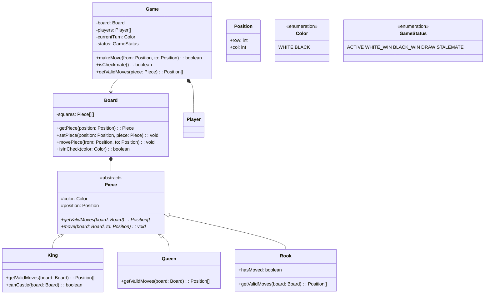

## Project 9 — Design Chess Game

**Problem:** Design a chess game with standard rules — board setup, piece movement, turn-based play, check/checkmate detection.

---

### Requirements

| Requirement | Details |
|-------------|---------|
| Board | 8×8 grid, initial piece setup |
| Pieces | King, Queen, Rook, Bishop, Knight, Pawn with correct movement |
| Turns | White moves first, alternate turns |
| Validation | Prevent illegal moves |
| Check/Checkmate | Detect check, checkmate, stalemate |
| Special moves | Castling, en passant, pawn promotion |

---

### Class Design



---

### Design Patterns Used

| Pattern | Where | Why |
|---------|-------|-----|
| **Abstract Factory** | Piece creation | Create pieces by type and color |
| **Strategy** | Move validation | Each piece has its own move logic |

---

### TypeScript Example

```typescript
enum Color { WHITE, BLACK }
enum GameStatus { ACTIVE, WHITE_WIN, BLACK_WIN, DRAW }

class Position {
  constructor(public row: number, public col: number) {}
  equals(other: Position): boolean { return this.row === other.row && this.col === other.col; }
}

abstract class Piece {
  constructor(public color: Color, public position: Position) {}
  abstract getValidMoves(board: Board): Position[];
  abstract getSymbol(): string;
}

class Pawn extends Piece {
  getValidMoves(board: Board): Position[] {
    const moves: Position[] = [];
    const dir = this.color === Color.WHITE ? -1 : 1;
    const startRow = this.color === Color.WHITE ? 6 : 1;
    
    // One step forward
    const oneStep = new Position(this.position.row + dir, this.position.col);
    if (board.isInBounds(oneStep) && !board.getPiece(oneStep)) {
      moves.push(oneStep);
      // Two steps from start
      if (this.position.row === startRow) {
        const twoSteps = new Position(this.position.row + 2 * dir, this.position.col);
        if (!board.getPiece(twoSteps)) moves.push(twoSteps);
      }
    }
    // Captures
    for (const dc of [-1, 1]) {
      const capture = new Position(this.position.row + dir, this.position.col + dc);
      if (board.isInBounds(capture)) {
        const target = board.getPiece(capture);
        if (target && target.color !== this.color) moves.push(capture);
      }
    }
    return moves;
  }
  
  getSymbol(): string { return this.color === Color.WHITE ? '♙' : '♟'; }
}

class Board {
  private grid: (Piece | null)[][] = Array.from({ length: 8 }, () => Array(8).fill(null));
  
  isInBounds(pos: Position): boolean {
    return pos.row >= 0 && pos.row < 8 && pos.col >= 0 && pos.col < 8;
  }
  
  getPiece(pos: Position): Piece | null { return this.grid[pos.row][pos.col]; }
  
  initialize(): void {
    // Set up pieces (simplified)
    const backRow = [Rook, Knight, Bishop, Queen, King, Bishop, Knight, Rook];
    for (let c = 0; c < 8; c++) {
      this.grid[0][c] = new (backRow[c])(Color.BLACK, new Position(0, c));
      this.grid[1][c] = new Pawn(Color.BLACK, new Position(1, c));
      this.grid[6][c] = new Pawn(Color.WHITE, new Position(6, c));
      this.grid[7][c] = new (backRow[c])(Color.WHITE, new Position(7, c));
    }
  }
}
```

---

### Interview Questions

1. **How do you detect checkmate?**
2. **How would you implement the undo feature?**
3. **How would you add an AI opponent?**
4. **How do you validate castling conditions?**
