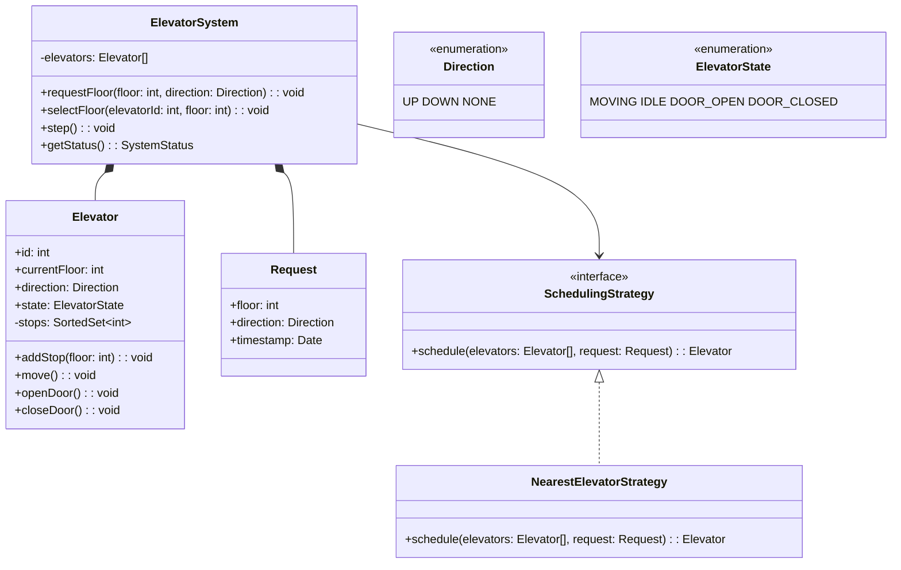

## Project 6 — Design Elevator System

**Problem:** Design an elevator control system that manages multiple elevators across multiple floors, handling requests efficiently.

---

### Requirements

| Requirement | Details |
|-------------|---------|
| Multiple elevators | N elevators serving M floors |
| Floor requests | Users press up/down on floors |
| Cabin requests | Users press floor number inside elevator |
| Scheduling | Assign nearest available elevator |
| States | Moving up, moving down, idle, door open |

---

### Class Design



---

### Design Patterns Used

| Pattern | Where | Why |
|---------|-------|-----|
| **Strategy** | Scheduling algorithm | Different scheduling strategies |
| **Singleton** | ElevatorSystem | One control system |

---

### JavaScript Example

```javascript
class Elevator {
  constructor(id, totalFloors) {
    this.id = id;
    this.currentFloor = 0;
    this.direction = 'NONE';
    this.state = 'IDLE';
    this.stops = new Set();
  }
  
  addStop(floor) {
    this.stops.add(floor);
    this.direction = floor > this.currentFloor ? 'UP' : 'DOWN';
  }
  
  move() {
    if (this.stops.size === 0) {
      this.direction = 'NONE';
      this.state = 'IDLE';
      return;
    }
    this.state = 'MOVING';
    this.currentFloor += this.direction === 'UP' ? 1 : -1;
    
    if (this.stops.has(this.currentFloor)) {
      this.stops.delete(this.currentFloor);
      this.state = 'DOOR_OPEN';
      // After delay, door closes
      setTimeout(() => { this.state = 'DOOR_CLOSED'; }, 2000);
    }
  }
  
  distanceFrom(floor) {
    return Math.abs(this.currentFloor - floor);
  }
}

class ElevatorSystem {
  constructor(numElevators, totalFloors) {
    this.elevators = Array.from({ length: numElevators }, 
      (_, i) => new Elevator(i, totalFloors));
  }
  
  requestFloor(floor, direction) {
    // Find nearest idle or moving-same-direction elevator
    let best = null;
    let minDist = Infinity;
    
    for (const e of this.elevators) {
      if (e.state === 'IDLE' || e.direction === direction) {
        const dist = e.distanceFrom(floor);
        if (dist < minDist) { minDist = dist; best = e; }
      }
    }
    
    if (best) best.addStop(floor);
  }
}
```

---

### Interview Questions

1. **How would you handle peak hours (office opening/closing)?**
2. **How would you implement emergency override (fire alarm)?**
3. **How do you prevent elevators from going to the same floor?**
4. **How would you add priority for handicapped or VIP users?**
