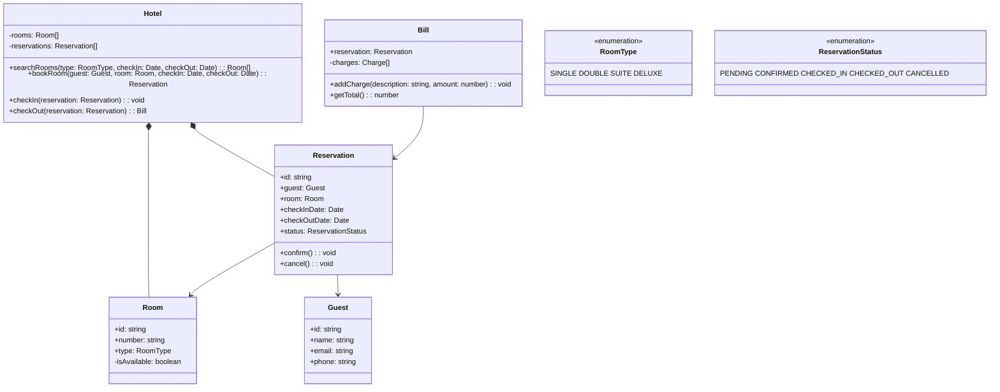

## Project 5 — Design Hotel Management System

**Problem:** Design a hotel management system with room categories, reservations, check-in/out, and billing.

---

### Requirements

| Requirement | Details |
|-------------|---------|
| Room types | Single, Double, Suite, Deluxe with different rates |
| Reservation | Book room for specific dates (max 30 days advance) |
| Check-in | Verify reservation, assign room |
| Check-out | Calculate charges, process payment |
| Availability | Check room availability by date range and type |

---

### Class Design



---

### TypeScript Example

```typescript
enum RoomType { SINGLE, DOUBLE, SUITE, DELUXE }
enum ReservationStatus { PENDING, CONFIRMED, CHECKED_IN, CHECKED_OUT, CANCELLED }

const ROOM_RATES: Record<RoomType, number> = {
  [RoomType.SINGLE]: 100,
  [RoomType.DOUBLE]: 150,
  [RoomType.SUITE]: 300,
  [RoomType.DELUXE]: 500,
};

class Reservation {
  public id: string = Math.random().toString(36).substr(2, 9);
  public status: ReservationStatus = ReservationStatus.PENDING;
  
  constructor(
    public guest: Guest,
    public room: Room,
    public checkInDate: Date,
    public checkOutDate: Date
  ) {}
  
  getNights(): number {
    return Math.ceil((this.checkOutDate.getTime() - this.checkInDate.getTime()) / (1000 * 60 * 60 * 24));
  }
  
  getEstimatedTotal(): number {
    return this.getNights() * ROOM_RATES[this.room.type];
  }
}

class Hotel {
  private rooms: Room[] = [];
  private reservations: Reservation[] = [];
  
  searchRooms(type: RoomType, checkIn: Date, checkOut: Date): Room[] {
    // Find rooms of this type that aren't reserved for the date range
    return this.rooms.filter(room => {
      if (room.type !== type) return false;
      return !this.reservations.some(res => 
        res.room.id === room.id &&
        res.status !== ReservationStatus.CANCELLED &&
        res.checkInDate < checkOut && res.checkOutDate > checkIn
      );
    });
  }
  
  bookRoom(guest: Guest, room: Room, checkIn: Date, checkOut: Date): Reservation {
    const reservation = new Reservation(guest, room, checkIn, checkOut);
    reservation.confirm();
    this.reservations.push(reservation);
    return reservation;
  }
}
```

---

### Interview Questions

1. **How would you handle overbooking?**
2. **How do you implement room service orders?**
3. **How would you add a loyalty program?**
4. **What happens if a guest doesn't show up?**
