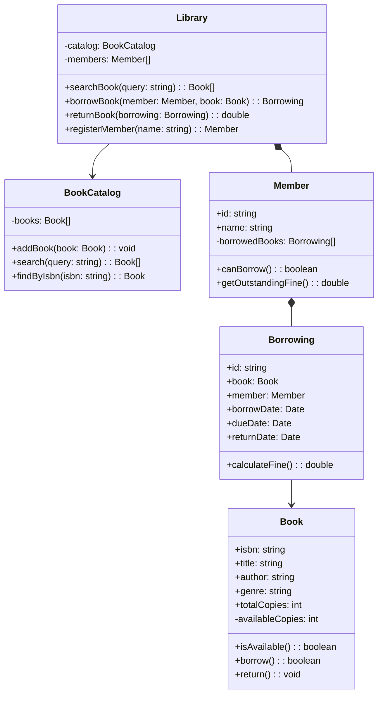

## Project 4 — Design Library Management System

**Problem:** Design a library management system for tracking books, members, borrowing/returns, and fine calculation.

---

### Requirements

| Requirement | Details |
|-------------|---------|
| Book catalog | Search books by title, author, genre |
| Members | Register members, track borrowed books |
| Borrowing | Check out books (max 5 per member, 14-day limit) |
| Returns | Return books, calculate late fines |
| Fines | $0.50/day overdue, track payments |

---

### Class Design



---

### TypeScript Example

```typescript
class Book {
  constructor(
    public isbn: string,
    public title: string,
    public author: string,
    public genre: string,
    public totalCopies: number,
    private availableCopies: number = totalCopies
  ) {}
  
  isAvailable(): boolean { return this.availableCopies > 0; }
  
  borrow(): boolean {
    if (!this.isAvailable()) return false;
    this.availableCopies--;
    return true;
  }
  
  returnBook(): void { this.availableCopies++; }
}

class Member {
  public borrowedBooks: Borrowing[] = [];
  
  constructor(public id: string, public name: string) {}
  
  canBorrow(): boolean {
    const active = this.borrowedBooks.filter(b => !b.returnDate).length;
    return active < 5;
  }
  
  getOutstandingFine(): number {
    return this.borrowedBooks
      .filter(b => !b.returnDate)
      .reduce((sum, b) => sum + b.calculateFine(), 0);
  }
}

class Borrowing {
  public borrowDate: Date = new Date();
  public dueDate: Date = new Date(Date.now() + 14 * 24 * 60 * 60 * 1000);
  public returnDate?: Date;
  
  constructor(public book: Book, public member: Member) {}
  
  calculateFine(): number {
    if (!this.returnDate) {
      const now = new Date();
      if (now <= this.dueDate) return 0;
      const daysOverdue = Math.ceil((now.getTime() - this.dueDate.getTime()) / (1000 * 60 * 60 * 24));
      return daysOverdue * 0.5; // $0.50/day
    }
    return 0;
  }
}
```

---

### Interview Questions

1. **How would you handle book reservations?**
2. **How do you prevent a member with fines from borrowing?**
3. **How would you add book recommendations?**
4. **How would you implement a waiting list for popular books?**
