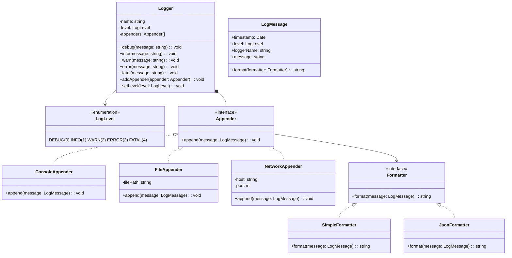

## Project 12 — Design Logging Framework

**Problem:** Design a flexible logging framework supporting multiple log levels, output destinations (console, file, network), and configurable formatting.

---

### Requirements

| Requirement | Details |
|-------------|---------|
| Log levels | DEBUG, INFO, WARN, ERROR, FATAL — configurable threshold |
| Appenders | Console, File, Network — send logs to different destinations |
| Formatting | Timestamp, level, message — customizable format |
| Configuration | Logger config via code, set level per class |
| Performance | Async logging, don't block the main thread |

---

### Class Design



---

### Design Patterns Used

| Pattern | Where | Why |
|---------|-------|-----|
| **Singleton** | LoggerFactory | Single logger management point |
| **Strategy** | Appender and Formatter | Swap output destination and format |

---

### TypeScript Example

```typescript
enum LogLevel { DEBUG = 0, INFO = 1, WARN = 2, ERROR = 3, FATAL = 4 }

class LogMessage {
  constructor(
    public timestamp: Date,
    public level: LogLevel,
    public loggerName: string,
    public message: string
  ) {}
}

interface Formatter {
  format(message: LogMessage): string;
}

class SimpleFormatter implements Formatter {
  format(message: LogMessage): string {
    return `[${LogLevel[message.level]}] ${message.timestamp.toISOString()} — ${message.message}`;
  }
}

interface Appender {
  append(message: LogMessage): void;
}

class ConsoleAppender implements Appender {
  constructor(private formatter: Formatter = new SimpleFormatter()) {}
  
  append(message: LogMessage): void {
    const output = this.formatter.format(message);
    if (message.level >= LogLevel.ERROR) console.error(output);
    else console.log(output);
  }
}

class FileAppender implements Appender {
  constructor(
    private filePath: string,
    private formatter: Formatter = new SimpleFormatter()
  ) {}
  
  append(message: LogMessage): void {
    // In production: write to file
    const output = this.formatter.format(message);
    console.log(`[File: ${this.filePath}] ${output}`);
  }
}

class Logger {
  private appenders: Appender[] = [];
  
  constructor(
    private name: string,
    private level: LogLevel = LogLevel.DEBUG
  ) {}
  
  addAppender(appender: Appender): void { this.appenders.push(appender); }
  setLevel(level: LogLevel): void { this.level = level; }
  
  private log(level: LogLevel, message: string): void {
    if (level < this.level) return;
    const logMessage = new LogMessage(new Date(), level, this.name, message);
    for (const appender of this.appenders) {
      appender.append(logMessage);
    }
  }
  
  debug(message: string): void { this.log(LogLevel.DEBUG, message); }
  info(message: string): void { this.log(LogLevel.INFO, message); }
  warn(message: string): void { this.log(LogLevel.WARN, message); }
  error(message: string): void { this.log(LogLevel.ERROR, message); }
  fatal(message: string): void { this.log(LogLevel.FATAL, message); }
}

// Usage
const logger = new Logger("MyApp", LogLevel.DEBUG);
logger.addAppender(new ConsoleAppender());
logger.addAppender(new FileAppender("/var/log/app.log", new JsonFormatter()));
logger.info("Application started");
```

---

### Interview Questions

1. **How would you implement async logging?**
2. **How would you add log rotation (new file per day)?**
3. **How do you ensure thread safety in a multi-threaded environment?**
4. **How would you implement a filter to exclude sensitive data from logs?**
