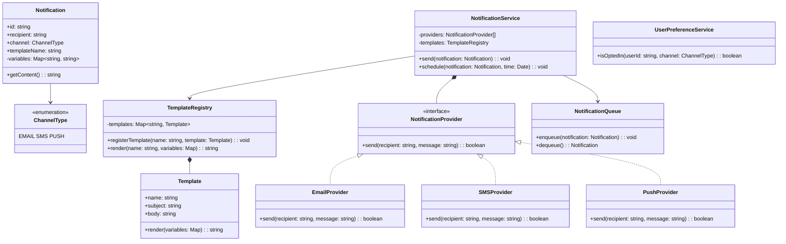

## Project 13 — Design Notification Service

**Problem:** Design a notification service that sends notifications via multiple channels (email, SMS, push) with template support and scheduling.

---

### Requirements

| Requirement | Details |
|-------------|---------|
| Channels | Email, SMS, Push notification |
| Templates | Reusable message templates with variables |
| Scheduling | Send immediately or at scheduled time |
| Delivery | At-least-once delivery with retry on failure |
| Preferences | Users can opt-in/out of channels |

---

### Class Design



---

### TypeScript Example

```typescript
enum ChannelType { EMAIL, SMS, PUSH }

interface NotificationProvider {
  send(recipient: string, message: string): Promise<boolean>;
}

class EmailProvider implements NotificationProvider {
  async send(recipient: string, message: string): Promise<boolean> {
    console.log(`📧 Sending email to ${recipient}: ${message}`);
    return true;
  }
}

class SMSProvider implements NotificationProvider {
  async send(recipient: string, message: string): Promise<boolean> {
    console.log(`📱 Sending SMS to ${recipient}: ${message}`);
    return true;
  }
}

class Template {
  constructor(public name: string, public body: string) {}
  
  render(variables: Map<string, string>): string {
    let result = this.body;
    variables.forEach((value, key) => {
      result = result.replace(`{{${key}}}`, value);
    });
    return result;
  }
}

class TemplateRegistry {
  private templates: Map<string, Template> = new Map();
  
  registerTemplate(template: Template): void {
    this.templates.set(template.name, template);
  }
  
  render(name: string, variables: Map<string, string>): string {
    const template = this.templates.get(name);
    if (!template) throw new Error(`Template "${name}" not found`);
    return template.render(variables);
  }
}

class Notification {
  constructor(
    public id: string,
    public recipient: string,
    public channel: ChannelType,
    public templateName: string,
    public variables: Map<string, string>
  ) {}
}

class NotificationService {
  private providers: Map<ChannelType, NotificationProvider> = new Map();
  
  constructor(
    private templateRegistry: TemplateRegistry,
    private maxRetries: number = 3
  ) {
    this.providers.set(ChannelType.EMAIL, new EmailProvider());
    this.providers.set(ChannelType.SMS, new SMSProvider());
  }
  
  registerProvider(channel: ChannelType, provider: NotificationProvider): void {
    this.providers.set(channel, provider);
  }
  
  async send(notification: Notification): Promise<boolean> {
    const provider = this.providers.get(notification.channel);
    if (!provider) throw new Error(`No provider for channel ${notification.channel}`);
    
    const message = this.templateRegistry.render(notification.templateName, notification.variables);
    
    for (let attempt = 1; attempt <= this.maxRetries; attempt++) {
      try {
        const success = await provider.send(notification.recipient, message);
        if (success) return true;
      } catch (error) {
        console.error(`Attempt ${attempt} failed: ${error}`);
        if (attempt === this.maxRetries) throw error;
        await new Promise(r => setTimeout(r, 1000 * Math.pow(2, attempt))); // Backoff
      }
    }
    return false;
  }
}
```

---

### Interview Questions

1. **How would you implement rate limiting per channel?**
2. **How do you handle provider failures gracefully?**
3. **How would you add delivery tracking (open rates, click rates)?**
4. **How would you implement batch sending for efficiency?**
