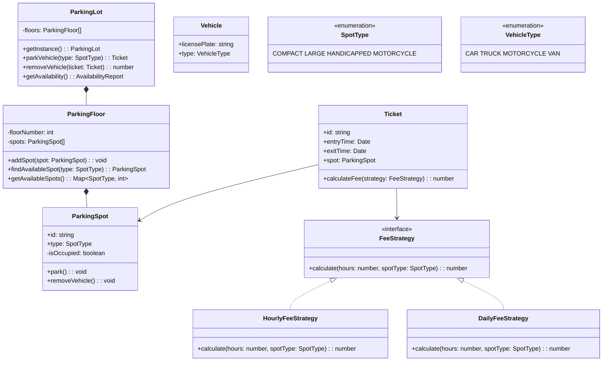

## Project 1 — Design Parking Lot

**Problem:** Design a parking lot system that manages multiple floors, different spot types, vehicle entry/exit, and fee calculation.

---

### Requirements

| Requirement | Details |
|-------------|---------|
| Multiple floors | Each floor has multiple parking spots |
| Spot types | Compact, Large, Handicapped, Motorcycle |
| Park vehicle | Find and assign available spot, generate ticket |
| Remove vehicle | Calculate fee based on duration and spot type |
| Availability | Track available spots per floor and type |

---

### Class Design



---

### Design Patterns Used

| Pattern | Where | Why |
|---------|-------|-----|
| **Singleton** | ParkingLot | Only one parking lot instance |
| **Strategy** | Fee calculation | Different fee strategies (hourly, daily) |
| **Factory** | Spot creation | Create spots by type |

---

### JavaScript Example

```javascript
// Enums
const SpotType = { COMPACT: 'COMPACT', LARGE: 'LARGE', HANDICAPPED: 'HANDICAPPED', MOTORCYCLE: 'MOTORCYCLE' };

// ParkingSpot class
class ParkingSpot {
  constructor(id, type) {
    this.id = id;
    this.type = type;
    this.isOccupied = false;
  }
  park() { this.isOccupied = true; }
  removeVehicle() { this.isOccupied = false; }
}

// Ticket class
class Ticket {
  constructor(spot) {
    this.id = Math.random().toString(36).substr(2, 9);
    this.spot = spot;
    this.entryTime = new Date();
    this.exitTime = null;
  }
  
  calculateFee(strategy) {
    this.exitTime = new Date();
    const hours = (this.exitTime - this.entryTime) / (1000 * 60 * 60);
    return strategy.calculate(hours, this.spot.type);
  }
}

// Fee strategies
class HourlyFeeStrategy {
  calculate(hours, spotType) {
    const rates = { COMPACT: 2, LARGE: 3, HANDICAPPED: 1, MOTORCYCLE: 1.5 };
    return Math.ceil(hours) * (rates[spotType] || 2);
  }
}

// ParkingLot (Singleton)
class ParkingLot {
  static instance = null;
  
  static getInstance() {
    if (!this.instance) this.instance = new ParkingLot();
    return this.instance;
  }
  
  constructor() {
    this.floors = [];
  }
  
  addFloor(floor) { this.floors.push(floor); }
  
  parkVehicle(spotType) {
    for (const floor of this.floors) {
      const spot = floor.findAvailableSpot(spotType);
      if (spot) {
        spot.park();
        return new Ticket(spot);
      }
    }
    return null;
  }
  
  removeVehicle(ticket) {
    ticket.spot.removeVehicle();
    return ticket.calculateFee(new HourlyFeeStrategy());
  }
}
```

---

### Interview Questions

1. **How would you add a reservation system?**
2. **How do you handle the case when all spots are full?**
3. **How would you implement different pricing for different hours?**
4. **How would you add VIP customer priority?**
