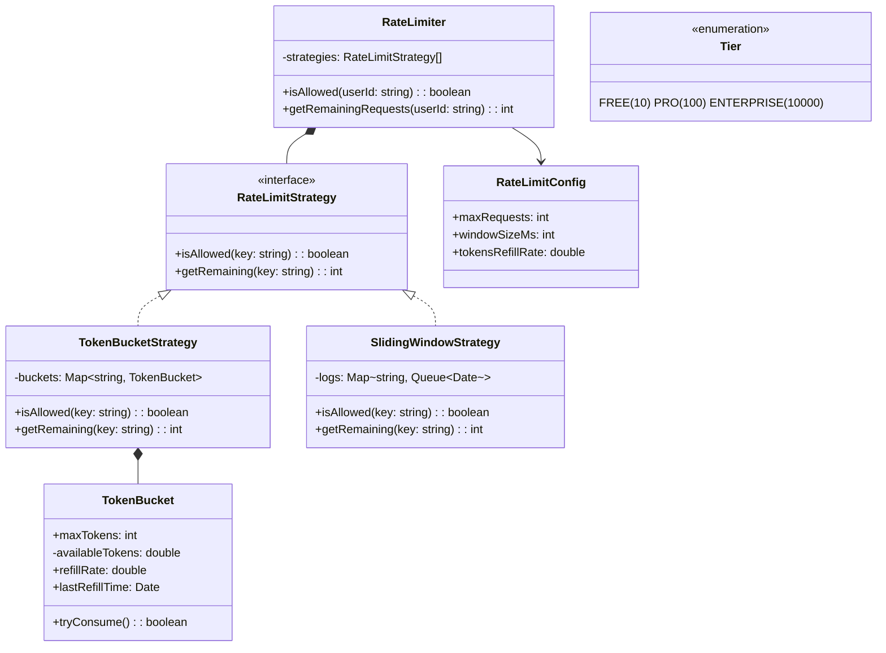

## Project 14 — Design Rate Limiter

**Problem:** Design a rate limiter that controls how many requests a user/IP can make within a time window. Used to prevent API abuse.

---

### Requirements

| Requirement | Details |
|-------------|---------|
| Rate limit | N requests per T seconds per user |
| Scope | Per user, per IP, global |
| Algorithms | Token bucket and sliding window |
| Response | Block request or return 429 Too Many Requests |
| Config | Dynamic rate limits per tier (free vs premium) |

---

### Class Design



---

### Design Patterns Used

| Pattern | Where | Why |
|---------|-------|-----|
| **Strategy** | Rate limiting algorithm | Swap between token bucket, sliding window |
| **Factory** | Strategy creation | Create strategy based on config |

---

### TypeScript Example

```typescript
interface RateLimitStrategy {
  isAllowed(key: string): boolean;
  getRemaining(key: string): number;
}

// Token Bucket Algorithm
class TokenBucket {
  private availableTokens: number;
  private lastRefillTime: number = Date.now();
  
  constructor(
    public maxTokens: number,
    private refillRate: number // tokens per second
  ) {
    this.availableTokens = maxTokens;
  }
  
  private refill(): void {
    const now = Date.now();
    const elapsed = (now - this.lastRefillTime) / 1000;
    this.availableTokens = Math.min(
      this.maxTokens,
      this.availableTokens + elapsed * this.refillRate
    );
    this.lastRefillTime = now;
  }
  
  tryConsume(): boolean {
    this.refill();
    if (this.availableTokens >= 1) {
      this.availableTokens -= 1;
      return true;
    }
    return false;
  }
}

class TokenBucketStrategy implements RateLimitStrategy {
  private buckets: Map<string, TokenBucket> = new Map();
  
  constructor(
    private maxTokens: number = 10,
    private refillRate: number = 1
  ) {}
  
  private getBucket(key: string): TokenBucket {
    if (!this.buckets.has(key)) {
      this.buckets.set(key, new TokenBucket(this.maxTokens, this.refillRate));
    }
    return this.buckets.get(key)!;
  }
  
  isAllowed(key: string): boolean {
    return this.getBucket(key).tryConsume();
  }
  
  getRemaining(key: string): number {
    return this.getBucket(key)['availableTokens']; // For illustration
  }
}

// Sliding Window Algorithm
class SlidingWindowStrategy implements RateLimitStrategy {
  private windows: Map<string, number[]> = new Map();
  
  constructor(
    private maxRequests: number = 10,
    private windowSizeMs: number = 60000 // 1 minute
  ) {}
  
  isAllowed(key: string): boolean {
    const now = Date.now();
    if (!this.windows.has(key)) this.windows.set(key, []);
    
    const timestamps = this.windows.get(key)!;
    // Remove old timestamps outside window
    while (timestamps.length > 0 && timestamps[0] < now - this.windowSizeMs) {
      timestamps.shift();
    }
    
    if (timestamps.length >= this.maxRequests) return false;
    
    timestamps.push(now);
    return true;
  }
  
  getRemaining(key: string): number {
    const now = Date.now();
    const timestamps = this.windows.get(key) || [];
    const active = timestamps.filter(t => t >= now - this.windowSizeMs).length;
    return Math.max(0, this.maxRequests - active);
  }
}

// RateLimiter (using Strategy pattern)
class RateLimiter {
  constructor(private strategy: RateLimitStrategy) {}
  
  setStrategy(strategy: RateLimitStrategy): void {
    this.strategy = strategy;
  }
  
  isAllowed(key: string): boolean { return this.strategy.isAllowed(key); }
  getRemaining(key: string): number { return this.strategy.getRemaining(key); }
}

// Usage
const limiter = new RateLimiter(new TokenBucketStrategy(10, 1)); // Max 10 req/sec

function handleRequest(userId: string): number {
  if (limiter.isAllowed(userId)) {
    return 200; // OK
  }
  return 429; // Too Many Requests
}
```

---

### Interview Questions

1. **How would you implement distributed rate limiting across multiple servers?**
2. **What happens to rate limits at scale (100K+ requests/second)?**
3. **How would you implement tier-based limits (free vs premium users)?**
4. **How would you add burst capability on top of steady-state limits?**
