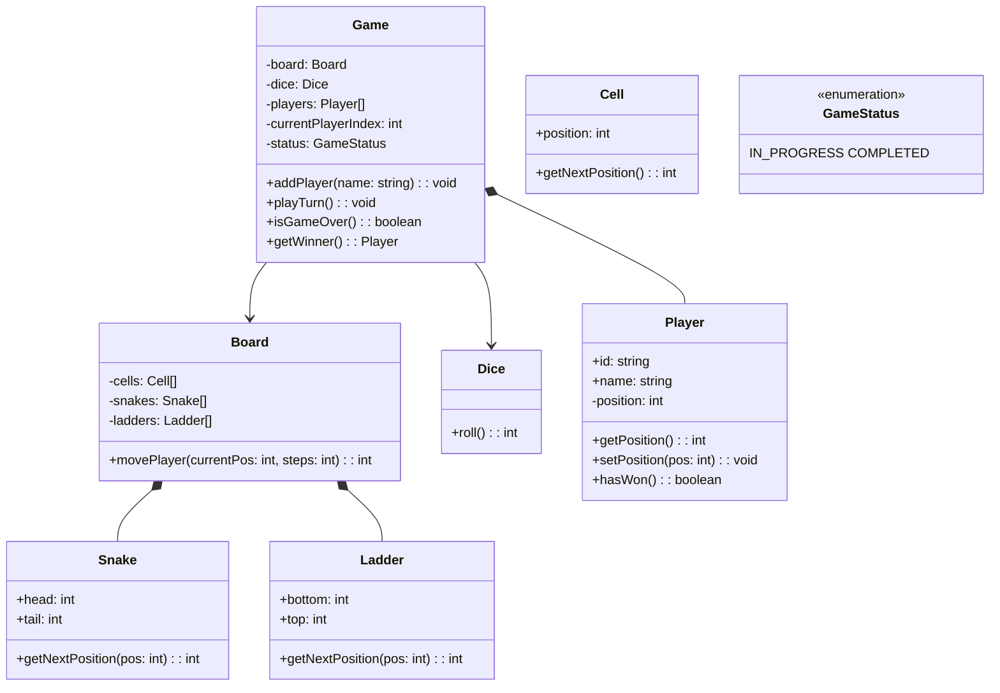

## Project 10 — Design Snake & Ladder

**Problem:** Design the classic Snake and Ladder game with multiple players, dice rolling, snakes (go down), and ladders (go up).

---

### Requirements

| Requirement | Details |
|-------------|---------|
| Board | 100 cells (1-100) |
| Players | 2-4 players, take turns rolling dice |
| Dice | Single die (1-6) |
| Snakes | Move player down (head > tail) |
| Ladders | Move player up (bottom > top) |
| Win condition | First player to reach exactly 100 |

---

### Class Design



---

### TypeScript Example

```typescript
class Dice {
  roll(): number { return Math.floor(Math.random() * 6) + 1; }
}

class Snake {
  constructor(public head: number, public tail: number) {
    if (head <= tail) throw new Error("Snake head must be above tail");
  }
}

class Ladder {
  constructor(public bottom: number, public top: number) {
    if (bottom >= top) throw new Error("Ladder bottom must be below top");
  }
}

class Board {
  constructor(
    public size: number = 100,
    private snakes: Snake[] = [],
    private ladders: Ladder[] = []
  ) {}
  
  getFinalPosition(position: number): number {
    // Check for snake or ladder
    for (const snake of this.snakes) {
      if (snake.head === position) {
        console.log(`🐍 Snake! Sliding down to ${snake.tail}`);
        return snake.tail;
      }
    }
    for (const ladder of this.ladders) {
      if (ladder.bottom === position) {
        console.log(`🪜 Ladder! Climbing up to ${ladder.top}`);
        return ladder.top;
      }
    }
    return position;
  }
}

class Player {
  public position: number = 0;
  constructor(public id: string, public name: string) {}
  
  hasWon(boardSize: number): boolean { return this.position === boardSize; }
}

class Game {
  private board: Board = new Board();
  private dice: Dice = new Dice();
  private players: Player[] = [];
  private currentPlayerIndex: number = 0;
  private status: 'IN_PROGRESS' | 'COMPLETED' = 'IN_PROGRESS';
  
  constructor() {
    // Initialize snakes and ladders
    this.board = new Board(100, [
      new Snake(16, 6), new Snake(47, 26), new Snake(49, 11),
      new Snake(56, 53), new Snake(62, 19), new Snake(64, 60),
      new Snake(87, 24), new Snake(93, 73), new Snake(95, 75), new Snake(98, 78),
    ], [
      new Ladder(1, 38), new Ladder(4, 14), new Ladder(9, 31),
      new Ladder(21, 42), new Ladder(28, 84), new Ladder(36, 44),
      new Ladder(51, 67), new Ladder(71, 91), new Ladder(80, 100),
    ]);
  }
  
  addPlayer(name: string): void {
    this.players.push(new Player(`P${this.players.length + 1}`, name));
  }
  
  playTurn(): string {
    if (this.status === 'COMPLETED') return "Game is over!";
    
    const player = this.players[this.currentPlayerIndex];
    const roll = this.dice.roll();
    let newPos = player.position + roll;
    
    if (newPos > this.board.size) {
      // Bounce back (exact win needed)
      this.currentPlayerIndex = (this.currentPlayerIndex + 1) % this.players.length;
      return `${player.name} rolled ${roll}. Need exact roll to win!`;
    }
    
    newPos = this.board.getFinalPosition(newPos);
    player.position = newPos;
    
    if (player.hasWon(this.board.size)) {
      this.status = 'COMPLETED';
      return `${player.name} rolled ${roll} and reached 100! 🎉 ${player.name} WINS!`;
    }
    
    this.currentPlayerIndex = (this.currentPlayerIndex + 1) % this.players.length;
    return `${player.name} rolled ${roll} → position ${newPos}`;
  }
}
```

---

### Interview Questions

1. **How would you implement the exact roll requirement for winning?**
2. **How would you add a 20-sided die for variation?**
3. **How do you handle multiple snakes/ladders on the same cell?**
4. **How would you implement a computer player (AI)?**
