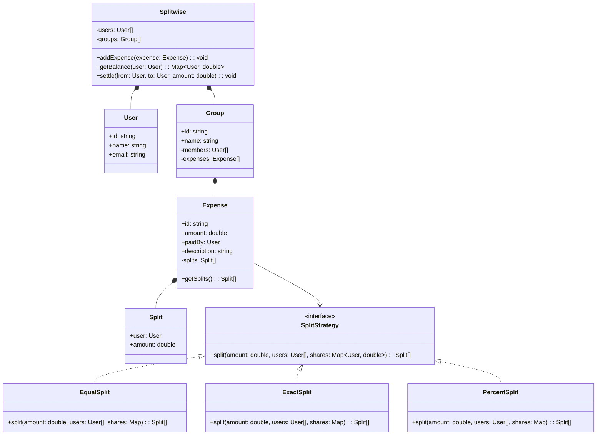

## Project 8 — Design Splitwise

**Problem:** Design an expense sharing application where users can split bills, track balances, and settle debts.

---

### Requirements

| Requirement | Details |
|-------------|---------|
| Users | Add users, manage profiles |
| Expenses | Add expenses (equal, exact, percentage split) |
| Groups | Create groups, add members, track group expenses |
| Balances | Show who owes whom, net balance |
| Settlements | Record payment settlements |

---

### Class Design



---

### Design Patterns Used

| Pattern | Where | Why |
|---------|-------|-----|
| **Strategy** | Split calculation | Different split methods (equal, exact, %) |
| **Factory** | Split strategy creation | Create strategy based on input |

---

### TypeScript Example

```typescript
interface SplitStrategy {
  split(amount: number, users: User[], shares: Map<string, number>): Split[];
}

class EqualSplit implements SplitStrategy {
  split(amount: number, users: User[], shares: Map<string, number>): Split[] {
    const perPerson = amount / users.length;
    return users.map(u => new Split(u, Math.round(perPerson * 100) / 100));
  }
}

class PercentSplit implements SplitStrategy {
  split(amount: number, users: User[], shares: Map<string, number>): Split[] {
    return users.map(u => new Split(u, Math.round(amount * (shares.get(u.id) ?? 0) / 100 * 100) / 100));
  }
}

class Expense {
  public splits: Split[] = [];
  
  constructor(
    public amount: number,
    public paidBy: User,
    public description: string,
    public splitStrategy: SplitStrategy,
    users: User[],
    shares: Map<string, number>
  ) {
    this.splits = splitStrategy.split(amount, users, shares);
  }
}

class Splitwise {
  private users: User[] = [];
  private expenses: Expense[] = [];
  
  addExpense(expense: Expense): void { this.expenses.push(expense); }
  
  getBalance(user: User): Map<string, number> {
    const balances = new Map<string, number>();
    
    for (const expense of this.expenses) {
      // User paid → others owe them
      for (const split of expense.splits) {
        if (split.user.id === user.id) {
          // User owes money (they didn't pay)
          if (expense.paidBy.id !== user.id) {
            balances.set(expense.paidBy.id, 
              (balances.get(expense.paidBy.id) ?? 0) - split.amount);
          }
        }
      }
      // User was paid by others (they paid the bill)
      if (expense.paidBy.id === user.id) {
        for (const split of expense.splits) {
          if (split.user.id !== user.id) {
            balances.set(split.user.id, 
              (balances.get(split.user.id) ?? 0) + split.amount);
          }
        }
      }
    }
    return balances;
  }
}
```

---

### Interview Questions

1. **How would you implement simplifying debts (minimum transactions)?**
2. **How do you handle rounding errors in percentage splits?**
3. **How would you add recurring expenses?**
4. **How would you implement a "scan receipt and split" feature?**
