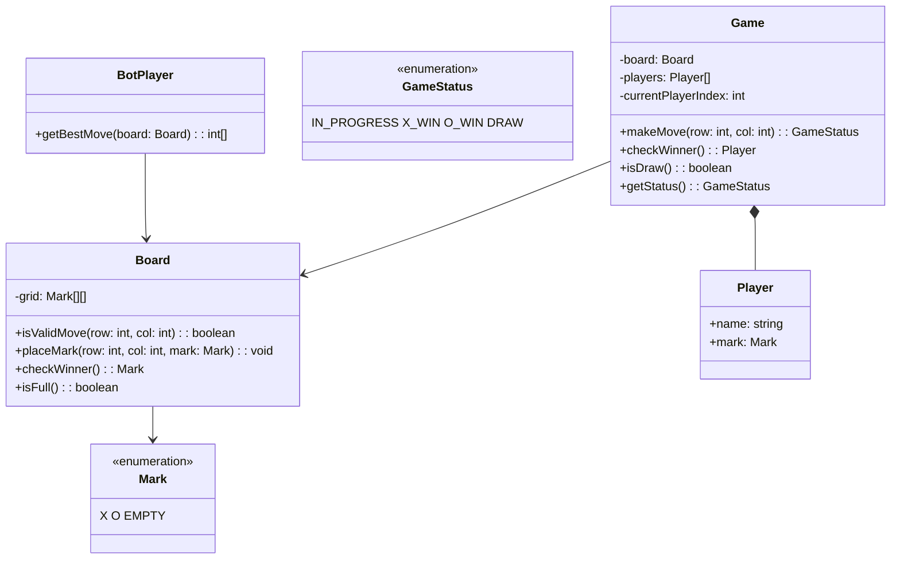

## Project 11 — Design Tic Tac Toe

**Problem:** Design a Tic Tac Toe game with a 3×3 board, two players, and win/draw detection.

---

### Class Design



---

### TypeScript Example

```typescript
enum Mark { X = 'X', O = 'O', EMPTY = ' ' }
enum GameStatus { IN_PROGRESS, X_WIN, O_WIN, DRAW }

class Board {
  private grid: Mark[][] = Array.from({ length: 3 }, () => Array(3).fill(Mark.EMPTY));
  
  isValidMove(row: number, col: number): boolean {
    return row >= 0 && row < 3 && col >= 0 && col < 3 && this.grid[row][col] === Mark.EMPTY;
  }
  
  placeMark(row: number, col: number, mark: Mark): void {
    this.grid[row][col] = mark;
  }
  
  getWinner(): Mark | null {
    // Check rows, columns, diagonals
    const lines = [
      // Rows
      ...this.grid,
      // Columns
      [this.grid[0][0], this.grid[1][0], this.grid[2][0]],
      [this.grid[0][1], this.grid[1][1], this.grid[2][1]],
      [this.grid[0][2], this.grid[1][2], this.grid[2][2]],
      // Diagonals
      [this.grid[0][0], this.grid[1][1], this.grid[2][2]],
      [this.grid[0][2], this.grid[1][1], this.grid[2][0]],
    ];
    
    for (const line of lines) {
      if (line[0] !== Mark.EMPTY && line[0] === line[1] && line[1] === line[2]) {
        return line[0];
      }
    }
    return null;
  }
  
  isFull(): boolean {
    return this.grid.every(row => row.every(cell => cell !== Mark.EMPTY));
  }
}

class Game {
  private board: Board = new Board();
  private players: Player[];
  private currentPlayerIndex: number = 0;
  
  constructor(player1Name: string, player2Name: string) {
    this.players = [
      new Player(player1Name, Mark.X),
      new Player(player2Name, Mark.O),
    ];
  }
  
  makeMove(row: number, col: number): GameStatus {
    const player = this.players[this.currentPlayerIndex];
    
    if (!this.board.isValidMove(row, col)) {
      throw new Error("Invalid move");
    }
    
    this.board.placeMark(row, col, player.mark);
    
    const winner = this.board.getWinner();
    if (winner) return winner === Mark.X ? GameStatus.X_WIN : GameStatus.O_WIN;
    if (this.board.isFull()) return GameStatus.DRAW;
    
    this.currentPlayerIndex = 1 - this.currentPlayerIndex;
    return GameStatus.IN_PROGRESS;
  }
}
```

---

### Interview Questions

1. **How would you implement an unbeatable AI (minimax algorithm)?**
2. **How would you add variable board sizes (4×4, 5×5)?**
3. **How would you add undo/redo functionality?**
4. **How would you implement a win streak counter?**
