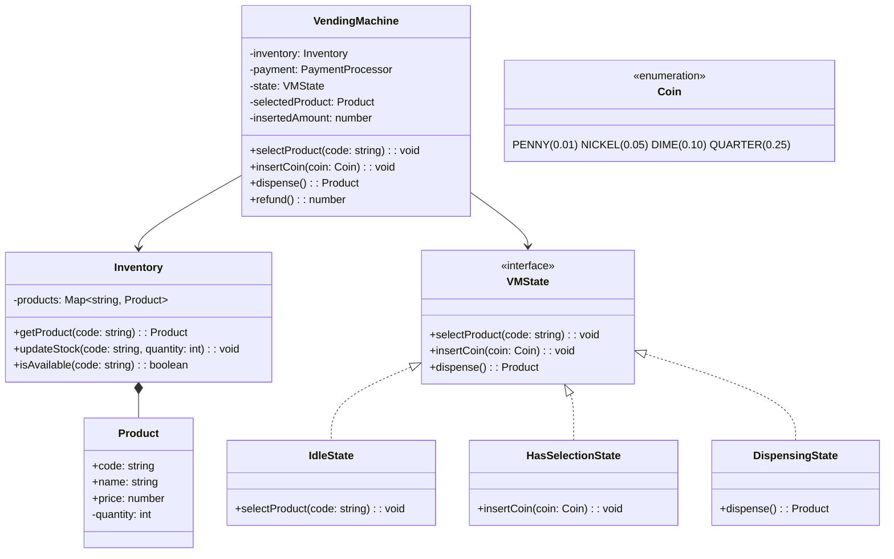

## Project 7 — Design Vending Machine

**Problem:** Design a vending machine that accepts coins/cards, displays products, dispenses items, and returns change.

---

### Requirements

| Requirement | Details |
|-------------|---------|
| Products | Multiple products with prices and inventory |
| Payment | Accept coins and cards |
| Selection | Select product by code |
| Dispensing | Dispense product and return change |
| Inventory | Track stock levels, show "sold out" |

---

### Class Design



---

### Design Patterns Used

| Pattern | Where | Why |
|---------|-------|-----|
| **State** | Vending machine states | Clean state transitions |
| **Singleton** | VendingMachine | One machine instance |

---

### TypeScript Example

```typescript
enum Coin { PENNY = 0.01, NICKEL = 0.05, DIME = 0.10, QUARTER = 0.25 }

class Product {
  constructor(
    public code: string,
    public name: string,
    public price: number,
    private quantity: number
  ) {}
  
  isAvailable(): boolean { return this.quantity > 0; }
  dispense(): void { if (this.quantity > 0) this.quantity--; }
}

class Inventory {
  private products: Map<string, Product> = new Map();
  
  addProduct(product: Product): void { this.products.set(product.code, product); }
  getProduct(code: string): Product | undefined { return this.products.get(code); }
  isAvailable(code: string): boolean { return this.products.get(code)?.isAvailable() ?? false; }
}

class VendingMachine {
  private inventory: Inventory = new Inventory();
  private insertedAmount: number = 0;
  private selectedProduct?: Product;
  
  selectProduct(code: string): string | null {
    const product = this.inventory.getProduct(code);
    if (!product || !product.isAvailable()) return null;
    this.selectedProduct = product;
    return `Selected ${product.name} — $${product.price}`;
  }
  
  insertCoin(coin: Coin): number {
    this.insertedAmount += coin;
    return this.insertedAmount;
  }
  
  dispense(): { product?: Product; change: number } {
    if (!this.selectedProduct) return { change: this.insertedAmount };
    if (this.insertedAmount < this.selectedProduct.price) {
      return { change: this.insertedAmount }; // Not enough money
    }
    
    this.selectedProduct.dispense();
    const change = this.insertedAmount - this.selectedProduct.price;
    this.insertedAmount = 0;
    this.selectedProduct = undefined;
    
    return { product: this.selectedProduct, change };
  }
}
```

---

### Interview Questions

1. **How would you handle exact change only mode?**
2. **How do you implement a loyalty card system?**
3. **What happens if a product gets stuck during dispensing?**
4. **How would you add a touchscreen interface with multiple categories?**
