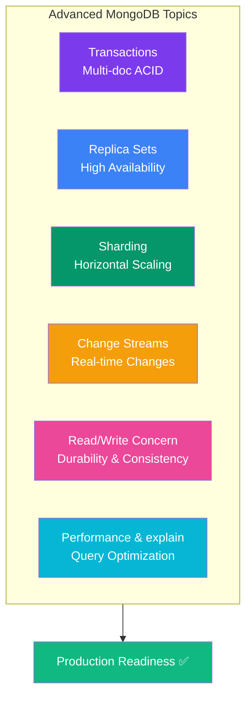

## Advanced Topics Hub

This page links to detailed pages for each advanced MongoDB topic.



### Advanced Topic Pages

| Topic | What it covers |
|-------|---------------|
| [Replication & Replica Sets](/DSA-Notes-Problems/mongodb/operations/replication-and-replica-sets) | Primary/secondary/arbiter, automatic failover, high availability |
| [Sharding](/DSA-Notes-Problems/mongodb/operations/sharding) | Splitting data across servers, shard key, chunks, mongos router |
| [Transactions](/DSA-Notes-Problems/mongodb/operations/transactions) | Multi-document ACID transactions, sessions, commit/abort |
| [Read & Write Concern](/DSA-Notes-Problems/mongodb/operations/read-write-concern) | Write concern (w, j), read concern, read preference — durability knobs |
| [Change Streams](/DSA-Notes-Problems/mongodb/operations/change-streams) | React to data changes in real time, resume tokens |
| [Performance & explain()](/DSA-Notes-Problems/mongodb/operations/performance-and-explain) | explain(), covered queries, spotting slow queries |

### Common Error Codes

| Code | Error | Common Cause |
|------|-------|-------------|
| 11000 | Duplicate key | Inserting a document that violates a unique index |
| 121 | Document validation failure | Document doesn't match $jsonSchema validation |
| 16500 | Too many requests | Atlas free tier throttling |
| 2 | BadValue | Invalid field/operator in query |
| 13 | Unauthorized | Authentication/permission issue |

```js
// Handle duplicate key error
try {
  await User.create({ email: "existing@example.com" });
} catch (err) {
  if (err.code === 11000) {
    const field = Object.keys(err.keyValue)[0];
    throw new Error(`${field} already exists`);
  }
  throw err;
}
```

### Performance Best Practices

```text
1. SCHEMA DESIGN
   ✅ Design schemas around your query patterns (query-first design)
   ✅ Embed data that's always accessed together
   ✅ Reference data that grows unboundedly

2. INDEXING
   ✅ Index every field used in find(), sort(), and $lookup
   ✅ Use compound indexes that match your queries (ESR rule)
   ✅ Use explain() to verify index usage

3. QUERIES
   ✅ Use projection — only return fields you need
   ✅ Use pagination (limit + skip or cursor-based)
   ✅ Put $match early in aggregation pipelines
   ❌ Avoid $where (JavaScript execution — very slow)

4. CONNECTIONS
   ✅ Use connection pooling (Mongoose does this by default)
   ✅ Set appropriate pool size for your app's concurrency

5. OPERATIONS
   ✅ Use bulk operations instead of loops
   ✅ Use $inc, $push instead of read-modify-write
   ✅ Use TTL indexes for auto-expiring data
```

---

### In Simple Words

- MongoDB's advanced features are now in dedicated pages — use the links above
- **Replica sets** give you high availability; **sharding** gives you horizontal scale
- **Transactions** ensure multi-document atomicity; **change streams** give real-time events
- Always use **explain()** to debug query performance
- The most common errors are **duplicate keys** (11000) and **validation failures** (121)

---

*📖 Full index: [MongoDB Overview →](/DSA-Notes-Problems/mongodb)*
