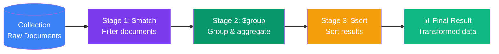

# Aggregation Framework

Aggregation is MongoDB's pipeline system for transforming, joining, grouping, and analyzing documents.

Think of it as:



Each stage receives documents from the previous stage and sends transformed documents to the next stage.

```text
documents -> stage -> stage -> stage -> result
```

## Sections

- [Pipeline Basics & Stages](/DSA-Notes-Problems/mongodb/aggregation-framework/pipeline-basics-stages/)
- [$match, $project, $sort, $limit, $skip](/DSA-Notes-Problems/mongodb/aggregation-framework/filter-project-sort-pagination/)
- [$group & Accumulators](/DSA-Notes-Problems/mongodb/aggregation-framework/group-accumulators/)
- [$lookup & $unwind](/DSA-Notes-Problems/mongodb/aggregation-framework/lookup-unwind/)
- [Expressions & Computed Fields](/DSA-Notes-Problems/mongodb/aggregation-framework/expressions-computed-fields/)
- [Real-World Examples](/DSA-Notes-Problems/mongodb/aggregation-framework/real-world-examples/)
- [Aggregation Optimization](/DSA-Notes-Problems/mongodb/aggregation-framework/aggregation-optimization/)

## Basic Syntax

```js
db.collection.aggregate([
  { $match: { status: "completed" } },
  { $group: { _id: "$userId", total: { $sum: "$totalAmount" } } },
  { $sort: { total: -1 } }
])
```

## Most Common Stages

| Stage | Purpose |
| --- | --- |
| `$match` | Filter documents |
| `$project` | Include, exclude, rename, or compute fields |
| `$group` | Group documents and calculate totals |
| `$sort` | Sort result documents |
| `$limit` | Keep only a fixed number of documents |
| `$skip` | Skip documents, often for pagination |
| `$lookup` | Join with another collection |
| `$unwind` | Flatten array values |
| `$addFields` | Add computed fields |

