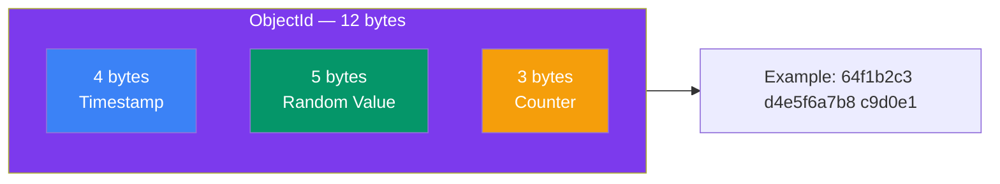

## Documents and Collections

MongoDB organizes data in a simple hierarchy: **Database → Collection → Document**.

### The Hierarchy

```mermaid
flowchart TB
    subgraph Server[MongoDB Server]
        subgraph DB1[Database: ecommerce]
            C1[Collection: users]
            C2[Collection: products]
            C3[Collection: orders]
        end
        subgraph DB2[Database: blog]
            C4[Collection: posts]
            C5[Collection: comments]
        end
    end
    
    C1 --> D1[Document: {name: \"Alice\"}]
    C1 --> D2[Document: {name: \"Bob\"}]
    C2 --> D3[Document: {name: \"Laptop\", price: 75000}]
    C2 --> D4[Document: {name: \"Mouse\", price: 1200}]
    
    style Server fill:#1e293b,color:#fff
    style DB1 fill:#7c3aed,color:#fff
    style DB2 fill:#7c3aed,color:#fff
    style C1 fill:#3b82f6,color:#fff
    style C2 fill:#3b82f6,color:#fff
    style C3 fill:#3b82f6,color:#fff
    style C4 fill:#3b82f6,color:#fff
    style C5 fill:#3b82f6,color:#fff
```

### Database

A MongoDB server can hold **multiple databases**. Each database is isolated (separate files on disk).

```js
use myapp        // switch to (or create) database called "myapp"
db               // shows current database
show dbs         // list all databases
```

### Collection

A collection is like a **table** — a group of related documents. But unlike SQL tables, collections don't enforce a schema.

```js
show collections                  // list collections in current db
db.createCollection("users")      // explicitly create a collection
db.users.drop()                   // delete a collection
```

> 💡 Collections are created **automatically** when you first insert data. You rarely need `createCollection()`.

### Document

A document is a **single record**, stored as BSON (Binary JSON). Think of it like a JavaScript object.

```json
{
  "_id": ObjectId("64f1b2c3d4e5f6a7b8c9d0e1"),
  "name": "Alice Johnson",
  "email": "alice@example.com",
  "age": 28,
  "address": {
    "city": "Mumbai",
    "state": "Maharashtra"
  },
  "tags": ["admin", "verified"],
  "createdAt": ISODate("2024-01-15T10:30:00Z")
}
```

### The `_id` Field

Every document **must have a unique `_id`** field. If you don't provide one, MongoDB auto-generates an **ObjectId**.



```js
// Auto-generated ObjectId
{ _id: ObjectId("64f1b2c3d4e5f6a7b8c9d0e1") }

// You can also use a custom _id
{ _id: "user_alice_001", name: "Alice" }
{ _id: 42, name: "Bob" }

// Extract timestamp from ObjectId
const id = new ObjectId("64f1b2c3d4e5f6a7b8c9d0e1");
id.getTimestamp(); // 2023-09-01T... (when it was created)

// Search by ObjectId (must use ObjectId(), not plain string)
db.users.findOne({ _id: ObjectId("64f1b2c3d4e5f6a7b8c9d0e1") })
```

### BSON vs JSON

MongoDB stores data as **BSON** (Binary JSON) internally. You write queries in JSON-like syntax, and MongoDB converts automatically.

| Feature | JSON | BSON |
|---------|------|------|
| Format | Text (human-readable) | Binary (machine-readable) |
| Speed | Slower to parse | Faster to parse |
| Data types | Limited (string, number, bool, array, object, null) | Extended (Date, ObjectId, Binary, Decimal128, etc.) |
| Size | Smaller text | Slightly larger binary |
| Used for | API responses, config files | MongoDB internal storage |

### MongoDB Data Types

```js
{
  _id:         ObjectId("64f1b2c3..."),     // Unique identifier
  name:        "Alice",                     // String
  age:         28,                          // Number (double by default)
  isActive:    true,                        // Boolean
  salary:      NumberDecimal("75000.50"),   // Decimal (precise)
  count:       NumberInt(42),               // 32-bit integer
  bigNum:      NumberLong(9007199254740993),// 64-bit integer
  createdAt:   ISODate("2024-01-15"),       // Date
  tags:        ["admin", "user"],           // Array
  address:     { city: "Mumbai" },          // Embedded object
  metadata:    null,                        // Null
  binaryData:  BinData(...),                // Binary data
}
```

---

### In Simple Words

- **Database** holds collections (like a folder)
- **Collection** holds documents (like a table, but schema-free)
- **Document** is a single record (like a JSON object)
- Every document has a unique **`_id`** — usually an auto-generated ObjectId
- MongoDB stores data as **BSON** (binary JSON) with support for more data types

---

*Next: [CRUD Operations →](/DSA-Notes-Problems/mongodb/core/fundamentals-crud)*
