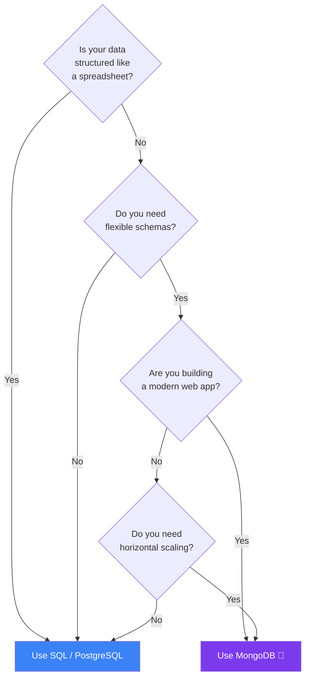

## What is MongoDB?

MongoDB is a **NoSQL, document-oriented database**. Instead of storing data in rows and columns like SQL, it stores data as **JSON-like documents**.

### Real-World Analogy

Think of a **filing cabinet with folders** vs a **spreadsheet**:

- **SQL (spreadsheet):** Every row has the same columns. If you add a new column, every row must have it (even if empty).
- **MongoDB (filing cabinet):** Each folder can contain different papers. One folder might have 3 pages, another might have 10. No two folders need to be exactly the same.

```text
SQL World              MongoDB World
─────────────────────  ─────────────────────
Database               Database
Table                  Collection
Row                    Document
Column                 Field
Primary Key            _id (ObjectId)
JOIN                   $lookup / Embedding
```

### Why MongoDB?

- **Flexible schema** — no rigid columns, documents in the same collection can have different fields
- **Scales horizontally** — split data across many servers (sharding)
- **Great for hierarchical data** — nested objects, arrays, embedded documents
- **Fast reads/writes** — optimized for modern web applications
- **Native JSON** — perfect for JavaScript/Node.js apps

### When to Use MongoDB



### Document Database vs SQL Table

```text
SQL Table: users
┌────────┬──────────┬─────┬──────────────┐
│ id     │ name     │ age │ phone        │
├────────┼──────────┼─────┼──────────────┤
│ 1      │ Alice    │ 28  │ 9876543210   │
│ 2      │ Bob      │ 35  │ NULL         │  ← must have phone column even if empty
└────────┴──────────┴─────┴──────────────┘

MongoDB Collection: users
┌──────────────────────────────────────────────┐
│ { _id: 1, name: "Alice", age: 28,           │
│   phone: "9876543210", skills: ["JS","Mongo"]│  ← can add fields freely
│ }                                            │
│ { _id: 2, name: "Bob", age: 35 }            │  ← no phone field needed
│ { _id: 3, name: "Charlie", address: {...} } │  ← different fields!
└──────────────────────────────────────────────┘
```

---

### In Simple Words

- MongoDB is a **document database** — stores data as JSON-like objects, not rows and columns
- It's **schema-flexible** — each document can have different fields
- Great for **modern web apps, real-time data, and hierarchical content**
- Use SQL when you need strict schemas and complex joins; use MongoDB when you need flexibility and scale

---

*Next: [Installation and Tools →](/DSA-Notes-Problems/mongodb/getting-started/installation-and-tools)*
