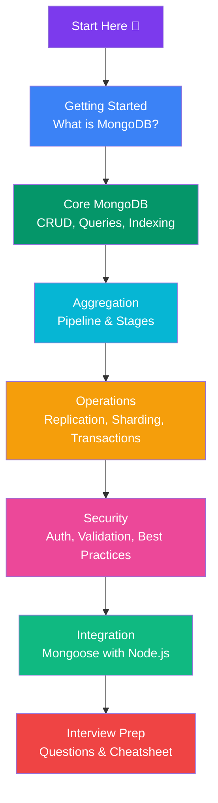

# MongoDB

Complete MongoDB notes from beginner to advanced.

## Learning Path

## Sections

### 🚀 Getting Started
- [What is MongoDB?](/DSA-Notes-Problems/mongodb/getting-started/what-is-mongodb) — Document database vs SQL, when to use it
- [Installation & Tools](/DSA-Notes-Problems/mongodb/getting-started/installation-and-tools) — mongosh, Compass, Atlas, drivers
- [Documents & Collections](/DSA-Notes-Problems/mongodb/getting-started/documents-and-collections) — Database hierarchy, `_id`, ObjectId, BSON types

### ⚡ Core MongoDB
- [Fundamentals & CRUD](/DSA-Notes-Problems/mongodb/core/fundamentals-crud) — Insert, find, update, delete operations
- [Query & Filtering](/DSA-Notes-Problems/mongodb/core/query-filtering) — Comparison, logical, array operators, projection, sorting
- [Data Modeling](/DSA-Notes-Problems/mongodb/core/data-modeling) — Embed vs reference, one-to-one, one-to-many, many-to-many
- [Indexing](/DSA-Notes-Problems/mongodb/core/indexing) — Single field, compound, text indexes, ESR rule, explain()

### 🔄 Aggregation Framework
- [Aggregation Overview](/DSA-Notes-Problems/mongodb/aggregation-framework) — Pipeline basics
- [Pipeline Basics & Stages](/DSA-Notes-Problems/mongodb/aggregation-framework/pipeline-basics-stages) — Stage order and rules
- [$match, $project, $sort](/DSA-Notes-Problems/mongodb/aggregation-framework/filter-project-sort-pagination) — Filtering, projection, sorting
- [$group & Accumulators](/DSA-Notes-Problems/mongodb/aggregation-framework/group-accumulators) — Grouping and aggregating data
- [$lookup & $unwind](/DSA-Notes-Problems/mongodb/aggregation-framework/lookup-unwind) — Joins and array flattening
- [Expressions & Computed Fields](/DSA-Notes-Problems/mongodb/aggregation-framework/expressions-computed-fields) — $addFields, string/date/array expressions
- [Real-World Examples](/DSA-Notes-Problems/mongodb/aggregation-framework/real-world-examples) — Practical aggregation pipelines
- [Aggregation Optimization](/DSA-Notes-Problems/mongodb/aggregation-framework/aggregation-optimization) — Performance tips

### ⚙️ Operations
- [Replication & Replica Sets](/DSA-Notes-Problems/mongodb/operations/replication-and-replica-sets) — High availability, failover, elections
- [Sharding](/DSA-Notes-Problems/mongodb/operations/sharding) — Horizontal scaling, shard key, mongos router
- [Transactions](/DSA-Notes-Problems/mongodb/operations/transactions) — Multi-document ACID transactions
- [Read & Write Concern](/DSA-Notes-Problems/mongodb/operations/read-write-concern) — Durability and consistency controls
- [Change Streams](/DSA-Notes-Problems/mongodb/operations/change-streams) — Real-time data change notifications
- [Performance & explain()](/DSA-Notes-Problems/mongodb/operations/performance-and-explain) — Query analysis and optimization

### 🔒 Security
- [Authentication & Authorization](/DSA-Notes-Problems/mongodb/security/authentication-and-authorization) — Users, roles, RBAC
- [Schema Validation](/DSA-Notes-Problems/mongodb/security/schema-validation) — $jsonSchema, enforcing document structure
- [Security Best Practices](/DSA-Notes-Problems/mongodb/security/security-best-practices) — Network, TLS, backups, least privilege

### 🔗 Integration
- [Mongoose — Node.js Integration](/DSA-Notes-Problems/mongodb/mongoose-nodejs-integration) — Schemas, models, validation, middleware, populate

### 📖 Interview & Revision
- [Top 100 Interview Questions](/DSA-Notes-Problems/mongodb/top-100-interview-questions) — Comprehensive Q&A from basic to advanced
- [Quick Reference Cheat Sheet](/DSA-Notes-Problems/mongodb/quick-reference-cheat-sheet) — CRUD commands, operators, aggregation, Mongoose reference
- [Advanced Topics Hub](/DSA-Notes-Problems/mongodb/advanced-topics) — Overview linking to detailed operation pages, error codes, best practices
