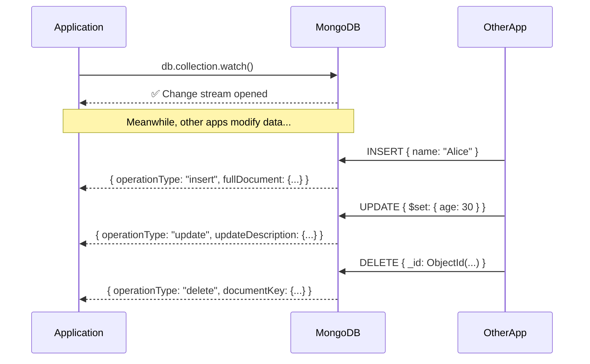
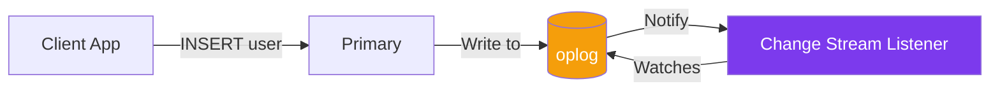

## Change Streams

Change streams let you **watch for data changes in real time** — like a live feed of every insert, update, and delete.

### Real-World Analogy

Think of a **newspaper subscription**:

- **Without change streams:** You call the newspaper every hour to ask "Any news?" (polling)
- **With change streams:** The newspaper delivers new editions to your doorstep the moment they're printed (push notifications)

### How Change Streams Work



### Basic Usage

```js
// Watch all changes on a collection
const changeStream = db.users.watch();

// Listen for changes
changeStream.on('change', (change) => {
  console.log('Change detected:', change);
});

// Output:
// { operationType: 'insert', fullDocument: { name: 'Alice', ... } }
// { operationType: 'update', updateDescription: { updatedFields: { age: 30 } } }
// { operationType: 'delete', documentKey: { _id: ObjectId(...) } }
```

### In Node.js with Mongoose

```js
const User = require('./models/User');

async function watchUsers() {
  const changeStream = User.watch();

  changeStream.on('change', (change) => {
    switch (change.operationType) {
      case 'insert':
        console.log('🆕 New user:', change.fullDocument.email);
        // Send welcome email, update cache, notify admins
        break;

      case 'update':
        console.log('✏️ User updated:', change.documentKey._id);
        // Invalidate cache, log the change
        break;

      case 'delete':
        console.log('🗑️ User deleted:', change.documentKey._id);
        // Clean up related data, notify admins
        break;
    }
  });

  console.log('👀 Watching for user changes...');
}
```

### Filtering Change Events

```js
// Watch only inserts and updates
const changeStream = db.users.watch([
  { $match: { operationType: { $in: ['insert', 'update'] } } }
]);

// Watch changes to specific fields
const changeStream = db.orders.watch([
  { $match: { 'updateDescription.updatedFields.status': { $exists: true } } }
]);

// Watch changes on a specific document
const changeStream = db.users.watch([
  { $match: { 'documentKey._id': ObjectId('user_id_here') } }
]);
```

### Resuming Change Streams

Change streams support **resume tokens** — if your app crashes, you can resume from where you left off.

```js
// Save the resume token
let resumeToken = null;

const changeStream = db.users.watch();

changeStream.on('change', (change) => {
  resumeToken = change._id;  // save this token
  processChange(change);
});

// On restart, resume from the saved token
const changeStream = db.users.watch([], { resumeAfter: resumeToken });
```

### Real-World Use Cases

| Use Case | How Change Streams Help |
|----------|------------------------|
| **Real-time notifications** | Watch for new orders and notify admins |
| **Cache invalidation** | Watch for user updates and invalidate Redis cache |
| **Search indexing** | Watch for new/updated posts and update Elasticsearch |
| **Audit logging** | Watch for all changes and log to an audit collection |
| **Data sync** | Watch for changes and sync to another database |

### Behind the Scenes: The Oplog



Change streams work by watching the **oplog** (operations log) — the same log that secondaries use for replication.

---

### In Simple Words

- **Change streams** give you a live feed of database changes (inserts, updates, deletes)
- Instead of **polling** (asking "anything new?" every second), MongoDB **pushes** changes to you
- You can **filter** which changes you care about (e.g., only inserts)
- Use **resume tokens** to recover from crashes without missing changes
- Great for real-time features, cache invalidation, and data sync

---

*Next: [Performance & explain() →](/DSA-Notes-Problems/mongodb/operations/performance-and-explain)*
