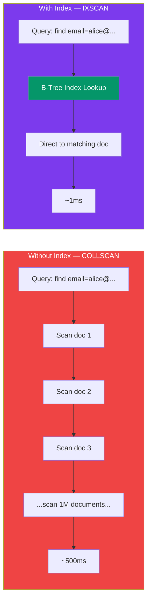
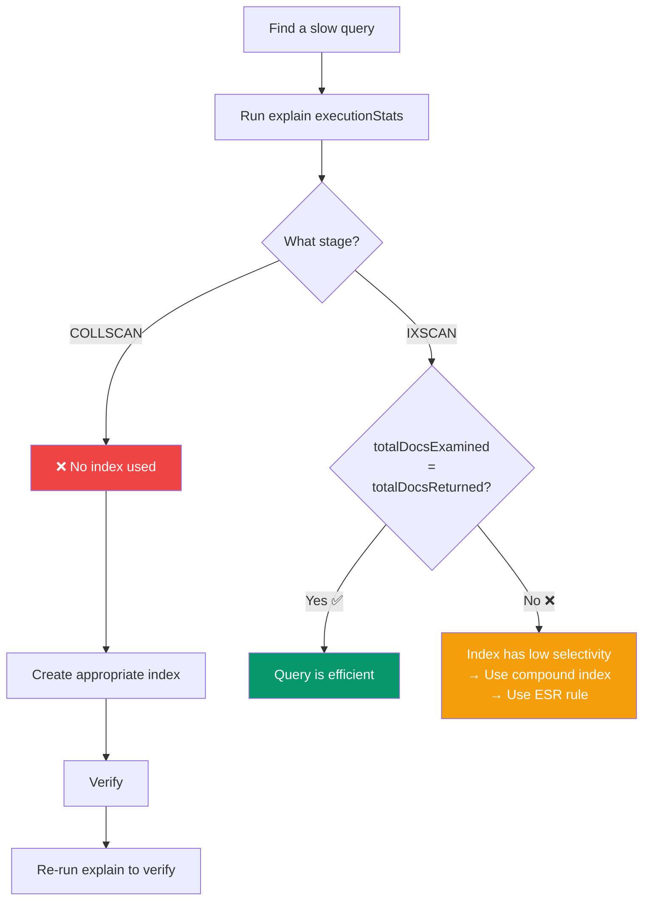

## Performance & explain()

Knowing how to analyze query performance is **critical** for production MongoDB. The `explain()` method is your best friend.

### Collection Scan vs Index Scan



### Using explain()

```js
// Three verbosity modes:
db.users.find({ email: "alice@example.com" }).explain()
// → queryPlanner: shows the plan MongoDB chose

db.users.find({ email: "alice@example.com" }).explain("executionStats")
// → executionStats: most useful for debugging

db.users.find({ email: "alice@example.com" }).explain("allPlansExecution")
// → allPlansExecution: most detailed, shows all candidate plans
```

### Reading explain() Output

```js
{
  executionStats: {
    executionTimeMillis: 2,         // ← How long it took (ms)
    totalDocsExamined: 1,           // ← Documents scanned
    totalDocsReturned: 1,           // ← Documents returned
    executionStages: {
      stage: "IXSCAN",              // ← IXSCAN = index scan (good!)
      indexName: "email_1",         // ← Which index was used
      // ... or "COLLSCAN" = collection scan (bad!)
    }
  }
}
```

### What to Look For

```text
✅ stage: "IXSCAN"           → Using an index (good)
❌ stage: "COLLSCAN"         → Full collection scan (needs an index!)

✅ totalDocsExamined ≈ totalDocsReturned  → Efficient query
❌ totalDocsExamined >> totalDocsReturned → Inefficient, low selectivity

✅ executionTimeMillis < 100             → Acceptable
⚠️  executionTimeMillis > 1000           → Slow, investigate!
```

### Covered Queries

A **covered query** is the fastest type of query — MongoDB can answer it **entirely from the index** without reading any documents.

```js
// Create index that covers the query:
db.users.createIndex({ email: 1, name: 1, role: 1 })

// This query is "covered" — all needed fields are in the index:
db.users.find(
  { email: "alice@example.com" },
  { name: 1, role: 1, _id: 0 }
)

// In explain() output, look for:
// "stage": "IXSCAN"
// "totalDocsExamined": 0  ← zero docs examined!
```

### Spotting Slow Queries



### Performance Best Practices

```text
1. SCHEMA DESIGN
   ✅ Design schemas around your query patterns (query-first design)
   ✅ Embed data that's always accessed together
   ✅ Reference data that grows unboundedly

2. INDEXING
   ✅ Index every field used in find(), sort(), and $lookup
   ✅ Use compound indexes (ESR rule: Equality → Sort → Range)
   ✅ Use explain() to verify index usage
   ❌ Don't over-index — each index slows down writes

3. QUERIES
   ✅ Use projection — only return fields you need
   ✅ Use pagination (limit + skip or cursor-based)
   ❌ Avoid $where (JavaScript — very slow)
   ❌ Avoid leading regex /^/ (can't use index)

4. EXPLAIN CHECKLIST
   [ ] Is it IXSCAN (not COLLSCAN)?
   [ ] Is totalDocsExamined close to totalDocsReturned?
   [ ] Is executionTimeMillis acceptable (< 100ms)?
   [ ] Can this be a covered query?
```

### Common MongoDB Performance Issues

| Symptom | Likely Cause | Fix |
|---------|-------------|-----|
| All queries are slow | No indexes | Create indexes on queried fields |
| Writes are slow | Too many indexes | Remove unused indexes |
| Queries slow on large collection | Wrong index order | Use ESR rule for compound indexes |
| `$lookup` is slow | No index on foreignField | Index the join field |
| Sorting is slow | Sort not using index | Add sort field to compound index |
| Memory high | Working set > RAM | Add more RAM or reduce index size |

---

### In Simple Words

- **explain()** shows you exactly how MongoDB executed your query — always use it to debug slow queries
- **IXSCAN** (index scan) is good; **COLLSCAN** (full collection scan) is bad
- A **covered query** reads from the index only — the fastest possible query
- Most performance problems are caused by **missing indexes** or **bad schema design**
- Always check: docs examined vs docs returned — they should be roughly equal

---

*Next: [Indexing →](/DSA-Notes-Problems/mongodb/core/indexing)*
