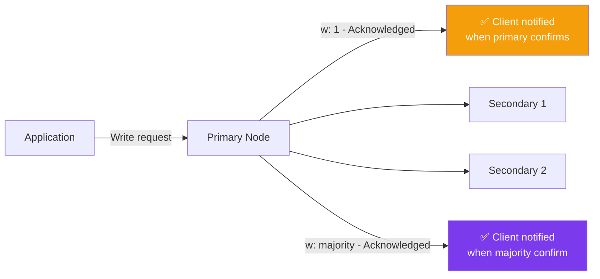
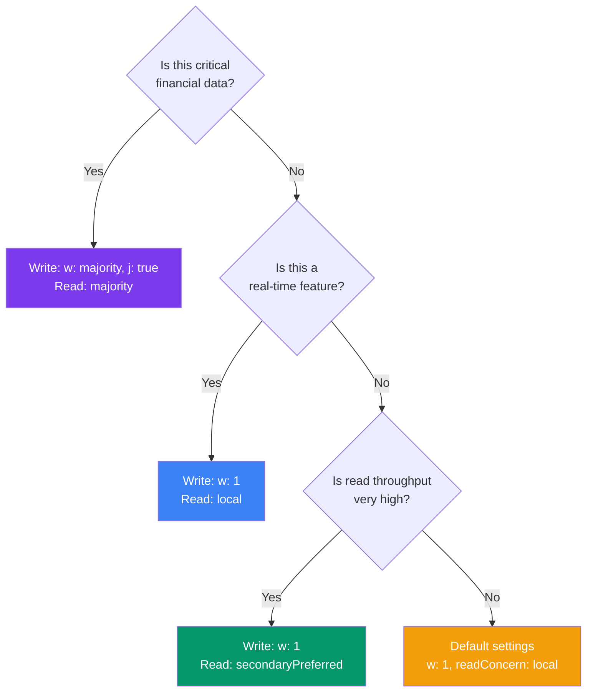

## Read & Write Concern

Write concern and read concern let you control **how safely data is written** and **how fresh the data you read is**.

### Real-World Analogy

Think of a **restaurant kitchen**:

- **Write Concern** (how safely is the order recorded?):
  - `w: 1` — The chef acknowledges they saw the order
  - `w: "majority"` — The chef AND two sous-chefs all confirm
  - `j: true` — The order is written in the permanent log book

- **Read Concern** (how fresh is the data you read?):
  - `local` — Whatever the waiter has in memory right now
  - `majority` — Only serve dishes that multiple chefs have confirmed

### Write Concern

Write concern controls **when a write operation is acknowledged as successful**.



```js
// Write concern options (in mongosh):
db.users.insertOne(
  { name: "Alice" },
  { writeConcern: { w: 1 } }              // default — primary confirms
)

db.users.insertOne(
  { name: "Alice" },
  { writeConcern: { w: "majority" } }     // majority of replica set confirms
)

db.users.insertOne(
  { name: "Alice" },
  { writeConcern: { w: "majority", j: true } }  // + journal (written to disk)
)

// In Mongoose:
await User.create({ name: "Alice" })  // default w: 1
await User.create({ name: "Alice" }, { w: "majority", j: true })
```

| Write Concern | Durability | Speed |
|--------------|-----------|-------|
| `w: 1` (default) | Primary confirms | ⚡ Fastest |
| `w: "majority"` | Most nodes confirm | 🐢 Slower |
| `w: "majority"` + `j: true` | Written to journal on most nodes | 🐌 Slowest but safest |
| `w: 0` | Fire and forget — no acknowledgement | ⚡ Fastest (risk of data loss) |

### Read Concern

Read concern controls **which data is visible to a read operation**.

```js
// Read concern options:
db.users.find().readConcern("local")          // default — whatever the node has
db.users.find().readConcern("majority")       // only data confirmed by majority
db.users.find().readConcern("linearizable")   // most recent, strongest guarantee
db.users.find().readConcern("available")      // fastest, no consistency guarantee
```

| Read Concern | Consistency | Speed | Use When |
|-------------|------------|-------|----------|
| `local` (default) | None | ⚡ Fastest | Non-critical reads |
| `majority` | High | 🐢 | Financial data, critical reads |
| `linearizable` | Absolute strongest | 🐌 | Absolute latest value needed |
| `available` | None | ⚡ Fast | Sharded collections, doesn't matter if stale |

### Read Preference

Read preference controls **which replica set member** handles the read.

```js
// In connection string:
mongoose.connect(uri, {
  readPreference: 'secondaryPreferred'
});

// Options:
// - primary:           Always primary (default)
// - primaryPreferred:  Primary first, fallback to secondary
// - secondary:         Always secondary
// - secondaryPreferred: Secondary first, fallback to primary
// - nearest:           Lowest latency node
```

### Choosing the Right Settings



---

### In Simple Words

- **Write concern** controls how many nodes confirm a write before the app is told "done"
- **Read concern** controls how fresh/consistent the data you read is
- **Read preference** controls which node handles your read (primary vs secondary)
- **Default settings** (`w: 1`, `local`) are fine for most apps
- Use **stronger settings** for financial/critical data; use **weaker settings** for speed

---

*Next: [Change Streams →](/DSA-Notes-Problems/mongodb/operations/change-streams)*
