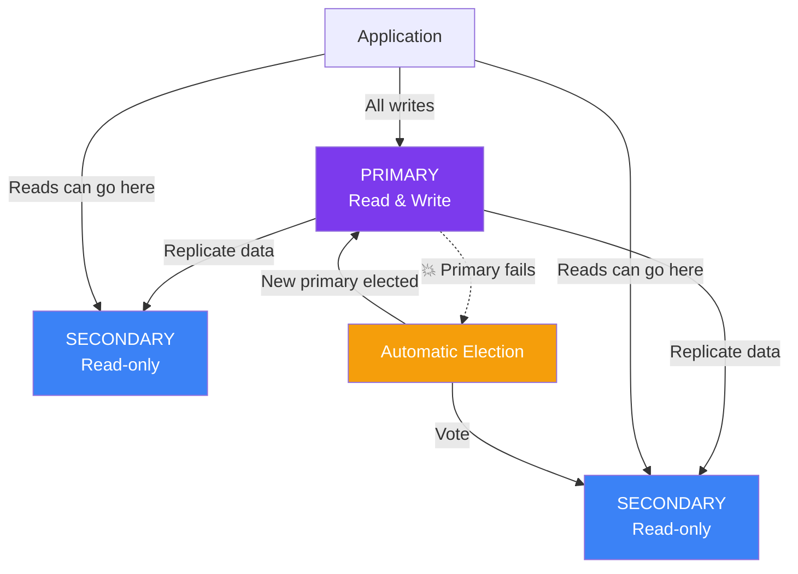

## Replication & Replica Sets

A **Replica Set** is a group of MongoDB servers that maintain the **same data** — providing high availability and automatic failover.

### Real-World Analogy

Think of a **captain and crew on a ship**:

- **Primary (Captain):** Gives all the orders. Only one captain at a time.
- **Secondaries (Crew):** Copy everything the captain does. Ready to take over if needed.
- **Election:** If the captain falls sick, the crew votes on who becomes the new captain.

### How It Works



### Key Points

- **All writes** go to the **Primary**
- **Reads** can go to Primary or Secondaries (configurable via read preference)
- If Primary fails, Secondaries **elect a new Primary** automatically
- **Minimum 3 nodes** recommended (1 primary + 2 secondaries), or 1 primary + 1 secondary + 1 arbiter
- **Required for Transactions**

### Why You Need a Replica Set

```text
Without Replica Set:
  ┌──────────┐
  │  Single  │  💥 Server crashes → app goes down → data lost
  │  Server  │
  └──────────┘

With Replica Set:
  ┌──────────┐     ┌──────────┐     ┌──────────┐
  │ Primary  │────▶│Secondary1│────▶│Secondary2│
  └──────────┘     └──────────┘     └──────────┘
       │                │                │
  💥 Primary fails     │  Automatic      │
       │               │  election       │
       └──────────────▶│  takes over     │
                       │  ✅ App stays up│
                       └─────────────────┘
```

### Membership Types

| Role | Can be Primary? | Can Vote? | Has Data? |
|------|----------------|-----------|-----------|
| **Primary** | ✅ Yes (current leader) | ✅ Yes | ✅ Full copy |
| **Secondary** | ✅ (can be elected) | ✅ Yes | ✅ Full copy |
| **Arbiter** | ❌ Never | ✅ Yes | ❌ No data (just votes) |
| **Delayed Secondary** | ❌ Never | ❌ No | ✅ Copies with delay (for rollback) |
| **Hidden Secondary** | ❌ Never | ✅ Yes (but not for election) | ✅ Full copy (for reporting/backup) |

### Read Preference

```js
// In connection string:
mongoose.connect(uri, {
  readPreference: 'secondaryPreferred'  // prefer secondaries for reads
});

// In mongosh:
db.getMongo().setReadPref('secondary');

// Options:
// - primary:           Only read from primary (default)
// - primaryPreferred:  Primary first, fallback to secondary
// - secondary:         Always read from secondary
// - secondaryPreferred: Secondary first, fallback to primary
// - nearest:           Lowest latency node
```

### Oplog (Operations Log)

The **oplog** is a special capped collection that records every write operation. Secondaries use it to replicate data.

```js
// Check oplog status
db.getReplicationInfo()

// Check replica set status
rs.status()
```

---

### In Simple Words

- A **replica set** is a group of MongoDB servers with the same data
- **Primary** handles writes; **Secondaries** copy data and can handle reads
- If the Primary fails, an **automatic election** picks a new Primary
- Replica sets give you **high availability** — your app stays up even if a server crashes
- You need at least **3 nodes** for a production replica set

---

*Next: [Sharding →](/DSA-Notes-Problems/mongodb/operations/sharding)*
