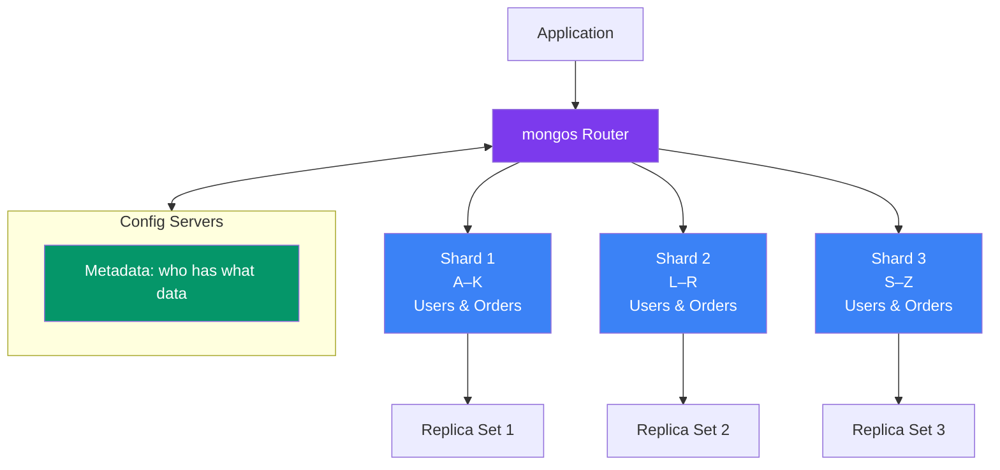
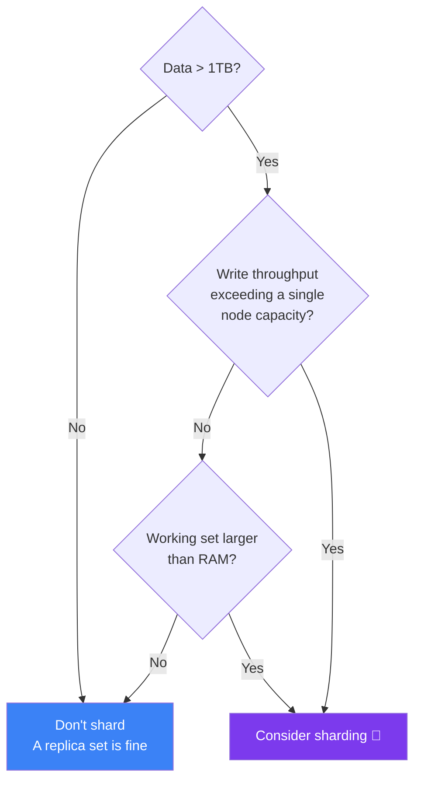

## Sharding

Sharding **splits data across multiple machines** — horizontal scaling for massive datasets.

### Real-World Analogy

Think of a **library with multiple floors**:

- **Without sharding:** All books on one floor. When the library grows, you run out of space.
- **With sharding:** Books are split by first letter: Floor 1 = A–K, Floor 2 = L–R, Floor 3 = S–Z. Each floor has its own shelves (and its own replica set for safety).
- **mongos router:** The librarian at the front desk who knows exactly which floor has the book you need.

### Sharding Architecture



### Components

| Component | What it does |
|-----------|-------------|
| **Shard** | A replica set that holds a portion of the data |
| **mongos Router** | Routes queries to the right shard(s) — acts like a smart proxy |
| **Config Servers** | Store metadata about which data lives on which shard |
| **Shard Key** | The field used to distribute documents across shards |

### The Shard Key

The **shard key** is the most important decision in sharding. It determines how data is distributed.

```js
// Enable sharding for a database
sh.enableSharding("ecommerce")

// Shard a collection by user_id
sh.shardCollection("ecommerce.orders", { userId: 1 })
```

```mermaid
flowchart LR
    subgraph Doc[Document]
        K[shard key: userId]
        D[...other fields]
    end
    
    Doc -->|hash(userId) → chunk| Chunks[Chunks of data<br/>distributed across shards]
    Chunks --> S1[Shard 1]
    Chunks --> S2[Shard 2]
    Chunks --> S3[Shard 3]
    
    style S1 fill:#3b82f6,color:#fff
    style S2 fill:#059669,color:#fff
    style S3 fill:#f59e0b,color:#fff
```

### Good vs Bad Shard Keys

```text
Good shard keys:
  ✅ High cardinality (many unique values)
  ✅ Even distribution across shards
  ✅ Used in most queries (so queries can target one shard)

Bad shard keys:
  ❌ Low cardinality (boolean, status, gender)
  ❌ Monotonically increasing (_id, timestamp) — creates "hot" shard
  ❌ Never appears in queries — forces broadcast to all shards
```

### When to Shard



### Types of Sharding

| Strategy | How it works | Best for |
|----------|-------------|----------|
| **Ranged Sharding** | Data split by value ranges (A–G, H–N, O–Z) | Queries by range (e.g., date range) |
| **Hashed Sharding** | Hash of shard key determines shard | Even distribution, random access patterns |
| **Zone Sharding** | Assign data to specific shards by zone | Geo-located data (users in India → Indian shards) |

```js
// Hashed sharding — best for even distribution
sh.shardCollection("ecommerce.orders", { userId: "hashed" })

// Zone sharding — keep Indian users on specific shards
sh.addShardTag("shard01", "India")
sh.addTagRange("ecommerce.users", { country: "India" }, { country: "India" }, "India")
```

---

### In Simple Words

- **Sharding** splits data across multiple servers so you can store more data and handle more writes
- A **shard key** determines which server each document goes to — choose wisely!
- **mongos** is the router that sends your queries to the right shard
- You probably **don't need sharding** until you have terabytes of data
- Each shard is itself a **replica set** for high availability

---

*Next: [Transactions →](/DSA-Notes-Problems/mongodb/operations/transactions)*
